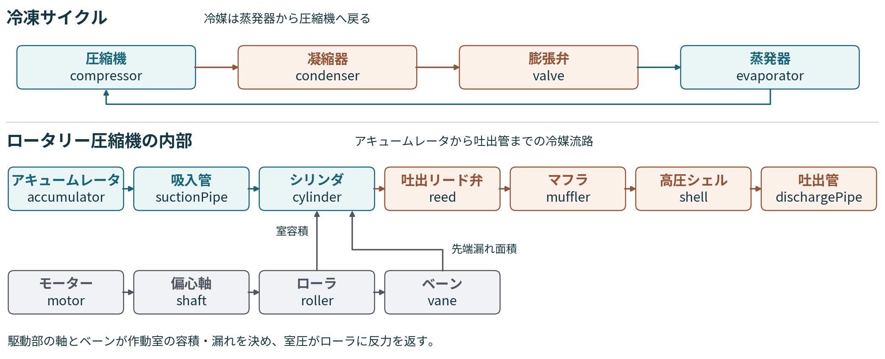
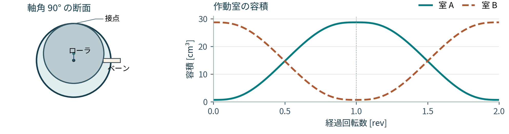
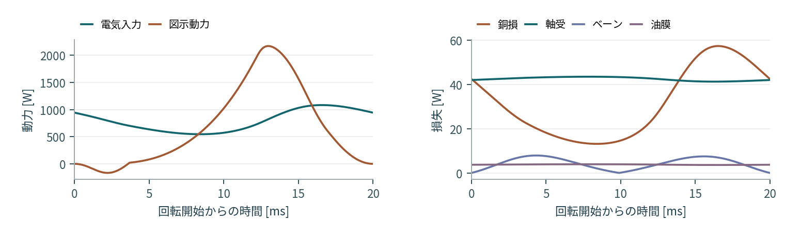

# 冷凍サイクルの部品・例題と物理方程式

**AirConditionerCycle 1.5.0　コンポーネント・例題ガイド**

冷房能力を調べるときは `Examples.RatedCooling`、圧縮機の中で吸入・圧縮・吐出が起こる順序を調べるときは `Examples.AdiabaticRotaryStandalone` を開きます。前者では回路が吸入・吐出圧力を決め、後者では試験台で両圧力を指定します。

図中の英字は OMEdit の**インスタンス名**です。例えば、圧縮機単体で作動室 A の圧力を表示するには `compressor.cylinder.pocketA.p`、閉回路なら `cycle.compressor.cylinder.pocketA.p` を選びます。部品解説で `reed.lift` と記した量は、単体例では `compressor.reed.lift` です。例題の節には、結果ブラウザーから選べる変数名を記します。圧力は絶対圧 [Pa]、温度は [K]、流量は [kg/s]、電力と熱流率は [W] です。

**部品を探す**

- [サイクルの機器](#サイクルの機器) ／ [圧縮機の選択と組立](#圧縮機の選択と組立)
- [アキュームレータ・吸入管・シリンダ](#吸入から作動室まで) ／ [リード弁・マフラ・シェル・吐出管](#吐出弁から吐出管まで)
- [モーター・偏心軸・ローラ・ベーン](#ロータリーの駆動部) ／ [共通クラスと冷媒物性](#共通クラスと冷媒物性)

**接続先・内部の変数を探す**

- [冷媒と熱のコネクタ](#冷媒と熱のコネクタ) ／ [機械フランジと作動室の容積ポート](#機械フランジと作動室の容積ポート)
- [制御信号と計測入力](#制御信号と計測入力) ／ [圧縮機の内部サブコンポーネント](#圧縮機の内部サブコンポーネント) ／ [例題の境界サブコンポーネント](#例題の境界サブコンポーネント)

**実行する例題を探す**

- [冷凍サイクルの例題](#冷凍サイクルの例題) ／ [圧縮機と部品の単体例題](#圧縮機と部品の単体例題) ／ [冷媒別の例題](#冷媒別の例題)
- [物理方程式の索引](#物理方程式の索引) から、個別の導出、初期条件、損失の定義、保存則の検査結果を引けます。

## サイクルの機器

### CoolingCycle　冷房回路

`compressor → condenser → valve → evaporator → compressor` の順に冷媒が流れます。外部接続は室内の熱ポート `roomAir` と室外の `outdoorAir` です。冷房能力は室内から入る熱 $Q_{cool}$、放熱量は室外へ出る熱 $Q_{rej}$ を正とし、電気入力が正のとき $\mathrm{COP}=Q_{cool}/P_{el}$ です。`pLow` と `pHigh` は圧縮機両端の圧力、`T1`～`T4` は上の流路を圧縮機入口からたどった四つの状態点です。第1章にポートの符号を示します。[実装](CoolingCycle.mo)

### DisplacementCompressor　標準圧縮機

蒸発器の蒸気を吸い込み、凝縮器へ送る押しのけ容積型です。入口密度 $\rho_1$、体積効率 `etaVol`、行程容積 `V_disp`、回転数 `speed` [rev/s] から $\dot m=\eta_v\rho_1 V_d n$ を求めます。既定は 28 cm³/rev、50 rev/s、体積効率 0.80。等エントロピー効率で吐出エンタルピーを決め、冷媒へ入る `P_shaft` をモーター効率で割った値が `P_el` です。吸入圧力が変わった場合は、まず `m_flow` と `suction` の密度の関係を確認します（第3章）。[本体](Components/DisplacementCompressor.mo)・[共通の圧縮式](Components/PartialIsentropicCompressor.mo)

### Condenser　凝縮器

圧縮機出口から高圧蒸気を受け、室外へ熱を渡して弁に液を送ります。冷媒保有量と壁の顕熱を蓄え、出口温度を $T_3=T_{sat}-\Delta T_{sc}$ とします。既定の `subcooling` は 5 K。室外温度を変えたときは `condenser.T_sat`、`cycle.T3`、`cycle.Q_rejected` を追うと、凝縮温度の変化と放熱の関係が読めます（第2章）。[実装](Components/Condenser.mo)

### ExpansionValve　膨張弁

凝縮器の液を蒸発圧力まで絞り、$h_4=h_3$ とします。蒸発器から受ける `level` が目標 `levelSet` を下回ると `opening` が増加します。流量は $C_d A_{max}\,\mathrm{opening}\sqrt{2\rho_{in}\Delta p}$、開度範囲は 0～1 です。`valve.dp`、`valve.opening`、弁出口乾き度 `cycle.x4` を確認します（第3章）。[実装](Components/ExpansionValve.mo)

### Evaporator　蒸発器

弁から入る二相冷媒が室内から吸熱し、圧縮機へ蒸気を送ります。出口温度は $T_1=T_{sat}+\Delta T_{sh}$、既定の `superheat` は 5 K。液の占める体積の割合 `liquidFraction` を `level` から膨張弁に返します。`evaporator.charge` は液と蒸気を合わせた質量 [kg]、`evaporator.level` は体積率です。`cycle.Q_cooling` と合わせて読むと、吸熱と冷媒在庫を区別できます（第2章）。[実装](Components/Evaporator.mo)

## 圧縮機の選択と組立

### RollingPistonCompressor　熱連成ロータリー

単気筒の高圧シェル型です。アキュームレータから吐出管までの7部品に、モーター、偏心軸、ローラ、ベーンの4部品を接続します。`motor.heat`、`shaft.heat`、`vane.heat`、`cylinder.wall` を `shell.wall` につなぎ、電動機・摩擦による発熱、作動室との熱交換、外気への放熱を解きます。圧縮機全体の `charge` は冷媒質量、`E` は冷媒・回転子・ベーン・シェル壁の蓄積エネルギーです。壁温は `shell.Twall`、外気への放熱は `shell.Q_ambient`。第10章で境界収支を確認できます。[実装](Components/Rotary/RollingPistonCompressor.mo)

### AdiabaticRollingPistonCompressor　断熱ロータリー

冷媒流路と機構は熱連成版と共通です。シリンダと高圧容器を断熱とし、圧力・比エンタルピーから吐出温度を求めます。電動機損失と軸・ベーンの摩擦を合計した `driveLoss` は冷媒への入熱から除きます。圧縮機に流入する正味の電気・機械動力は $P_{el}-P_{loss}$、壁を含まない蓄積量は `E` です。部品の損失と室内の圧力を先に調べたい場合に使います。両モデルを同じ境界で比較する手順と収支は第17章にあります。[実装](Components/Rotary/AdiabaticRollingPistonCompressor.mo)

### PartialRollingPiston　共通の組立

`inlet`、`outlet`、`P_el` が冷凍回路との接点です。内部では `motor → shaft → roller` が軸トルクを伝え、ローラとシリンダは二つの容積ポートを介して圧力仕事を交換します。`speed`、`cylinderRadius`、`eccentricity`、`height` を組立側で与えると対応する部品に渡されます。`useDetailedLosses` の既定は false。true にすると銅損・鉄損と端面油膜抵抗を計算し、計測用の `losses` が現れます。[実装と接続図](Components/Rotary/BaseClasses/PartialRollingPiston.mo)

### LossReport　損失と効率の集計

軸の完了回転数、吸吐出流量、漏れ流量、各動力を受け取ります。`power` は瞬時値、`meanPower` は完了した直前1回転の積分平均です。例えば `copper` は銅損、`indicated` は二室への図示動力、`electric` は電気入力。3者を同じ時間区間で比較します。`volumetricEfficiency` は吐出質量／理論吸入質量、`isentropicEfficiency` は等エントロピー仕事／電気エネルギーです。最初の回転完了まで平均出力は初期値です。吸入、吐出、漏れの圧損仕事率は流路の診断値で、電力収支にもう一度加えると二重計上になります（第14～16章）。[実装](Components/Rotary/LossReport.mo)

### FixedFlowCompressor　交換確認用圧縮機

`Examples` に置かれた試験用部品です。`PartialIsentropicCompressor` の吐出状態・電力計算を使い、流量式だけを $\dot m=\mathrm{m\_set}$ とします。既定は 0.016 kg/s。運転条件は `CompressorReplacement` が供給します。自作圧縮機を接続するときは、この例の `cycle(redeclare model Compressor = …)` が交換箇所です。[部品](Examples/FixedFlowCompressor.mo)・[接続例](Examples/CompressorReplacement.mo)

## 吸入から作動室まで

以下の `accumulator`、`suctionPipe`、`cylinder` は圧縮機の内部名です。圧力降下を切り分けるには、吸入境界、容器、吸入管出口、吸入中の作動室の順に圧力を重ねます。

### Accumulator　吸入アキュームレータ

圧縮機入口で気液を分離し、上部の蒸気を吸入管へ送ります。容器容積は 550 cm³。均質平衡状態から乾き度 $x$ を求め、保持液量を $M_l=M(1-x)$ とします。出口比エンタルピーは容器の $h$ とその圧力での飽和蒸気値の大きい方です。湿り吸入時は `accumulator.liquidMass` が増えても、出口からは蒸気を取り出します。試験台では `inletCheckValve=true` とし、上流からの差圧がゼロ以下になると流入を止めます。入口絞り `inletArea` の効果は `inlet.p` と `gas.p` の差に現れます（第5章）。[実装](Components/Rotary/Accumulator.mo)

### SuctionPipe　吸入管

アキュームレータ出口とシリンダの吸入口を結ぶ断熱管です。長さ 0.16 m、内径 12 mm、局部損失係数 1.2。共通の `Pipe` が直管摩擦と局部損失を足し、入口密度と流量から `dp` を計算します。出口の比エンタルピーは入口と等しく、管内の質量蓄積はありません。`suctionPipe.dp` が管の差圧、`cylinder.inlet.p - cylinder.pSuction` が次の吸入ポートの差圧です（第5章）。[吸入管](Components/Rotary/SuctionPipe.mo)・[共通の圧損式](Components/Rotary/BaseClasses/Pipe.mo)

### Cylinder　シリンダと二つの作動室

吸入管と吐出リード弁の間にあります。ローラから容積と `fillingA`、ベーンから `leakArea` を受け取ります。偶数の完了回転数では A が吸入、B が圧縮・吐出を担い、次の回転では逆になります。A から B への漏れを正の `leakAB` とし、上流室の比エンタルピーを漏れとともに移送します。各室の収支は $\dot U=\sum_j\dot m_j h_j+\dot Q-p\dot V$。容積が縮むと $-p\dot V$ が正になり、軸から冷媒に仕事が入ります。熱連成版の入熱は各室で $G_{wall}(T_{wall}-T_{gas})$ です。`cylinder.pocketA.p`、`cylinder.pocketB.p`、`roller.angle` で各室の過程を読めます（第6・7章）。[熱連成シリンダ](Components/Rotary/Cylinder.mo)・[吸入・漏れの共通式](Components/Rotary/BaseClasses/PartialCylinder.mo)

### Adiabatic.Cylinder　断熱シリンダ

同じ吸入ポート、二室、容積変化と漏れ流路を使い、両室の `Q_flow` をゼロにします。熱連成版と比べるときは、同じ吸入圧力・背圧・回転数指令で、同じ回転の `pocketA.p` と `pocketA.T` を重ねます。壁温の設定は不要です（第17章）。[断熱シリンダ](Components/Rotary/Adiabatic/Cylinder.mo)

## 吐出弁から吐出管まで

### DischargeReed　吐出リード弁

シリンダとマフラの差圧から目標リフトを求めます。開き始めの差圧 `crackingPressure` は 4.5 kPa、最大目標リフト `liftMax` は 1 mm。弁の有効質量・ばね・減衰で実リフトが目標に追従し、リフトから開口面積と正方向のノズル流量が決まります。`reed.lift` [m] と `reed.m_flow` [kg/s] を重ねると、弁の変位と実際の吐出パルスの時間差を読めます（第8章）。[実装](Components/Rotary/DischargeReed.mo)

### Muffler　吐出マフラ

リード弁出口の脈動流を受ける 85 cm³ の断熱膨張室です。入口圧力は容器圧力に一致し、出口絞り `exitArea` で圧力が下がります。出口流量を $q=-\mathrm{outlet.m\_flow}$ とすれば、$p_{gas}-p_{out}=q|q|/(2\rho A_{exit}^2)$。弁直後の流量と `muffler.gas.p` を比べると、冷媒の蓄積が圧力脈動にどう現れるかが分かります。周波数別の音響減衰は扱いません（第8章）。[実装](Components/Rotary/Muffler.mo)

### Shell　熱連成高圧シェル

マフラ出口と吐出管を結び、850 cm³ の吐出ガスと熱容量 `Cwall` の壁を持ちます。機械・電動機・作動室と `wall` で熱を交換し、壁・ガス間は `Ggas`、壁・外気間は `Gambient` で結びます。$C_{wall}\dot T_{wall}=\dot Q_{wall}-\dot Q_{gas}-\dot Q_{ambient}$。`shell.gas.T` は冷媒温度、`shell.Twall` は金属壁温度、`shell.Q_ambient` は壁から外気への熱流率です（第8・10章）。[実装](Components/Rotary/Shell.mo)

### Adiabatic.DischargePlenum　断熱高圧シェル

断熱版で `shell` の位置に入る吐出ガス容器です。入口・出口は同じ圧力で、出口には容器内の比エンタルピーを渡します。容器の入熱はゼロですが、ガスの質量と内部エネルギーは蓄積するため、`shell.gas.p` と `shell.gas.T` は時間変化します。吐出管での圧力降下の前にある温度を観測できます（第17章）。[実装](Components/Rotary/Adiabatic/DischargePlenum.mo)

### DischargePipe　吐出管

シェル出口を冷凍回路の凝縮器入口または単体試験の吐出リザーバにつなぎます。長さ 0.20 m、内径 8 mm、局部損失係数 1.8。吸入管と同じ断熱圧損式を出口側の寸法・上流密度で解きます。`dischargePipe.dp` が管の圧損、`-compressor.outlet.m_flow` が圧縮機から出る正の流量です。リード弁と吐出管の瞬時流量の差は、途中の容器に冷媒が蓄積できるために生じます（第5・8章）。[実装](Components/Rotary/DischargePipe.mo)

## ロータリーの駆動部

### Motor　熱連成モーター

PI 速度制御器が指令 `speed` と実速度から電磁トルク `driveTorque` を決めます。ロータの運動は $J\dot\omega=\tau_m+\tau_{shaft}$。電気入力 `P_el` と電磁動力 $\tau_m\omega$ の差がシェルへ渡る発熱です。詳細損失を選ぶと、壁に接続した `heat.T` で巻線相抵抗を補正し、三相銅損 $3RI^2$、鉄損、一定付帯損失を計算します。`motor.w` は rad/s、実回転数 [rpm] は $60\omega/(2\pi)$ です（第9・14章）。[熱連成モーター](Components/Rotary/Motor.mo)・[制御と電力の共通式](Components/Rotary/BaseClasses/PartialMotor.mo)

### Adiabatic.Motor　断熱版のモーター

同じ速度制御、トルク上限、回転子慣性を持ち、詳細損失時には一定の運転時相抵抗 `operatingResistance`（既定 0.36 Ω）で銅損を計算します。熱ポートを介した発熱の伝達は省き、電気入力と電磁動力の差は圧縮機の `driveLoss` に含めます。`motor.copperLoss` と `motor.ironLoss` で内訳を確認できます（第14・17章）。[実装](Components/Rotary/Adiabatic/Motor.mo)

### EccentricShaft　偏心軸

モーターにつながる `shaft.drive` とローラにつながる `shaft.crank` の軸角を等しく保ち、両端のトルクの和で摩擦トルクを支えます。軸受には乾性摩擦と粘性摩擦があり、詳細損失時には油粘度・膜厚・端面形状で決まる油膜トルクが加わります。軸の散逸動力は $\tau_f\omega$。`shaft.bearingTorque` と `shaft.oilFilmLoss` はそれぞれ N·m と W です。熱連成版は散逸をシェルへ渡し、断熱版では `ShaftMechanics` をそのまま使います（第9・14章）。[熱ポート付き軸](Components/Rotary/EccentricShaft.mo)・[軸の運動と摩擦](Components/Rotary/BaseClasses/ShaftMechanics.mo)

### Roller　ローラ

偏心軸の角度から二つの作動室容積とベーン先端位置を求め、室圧を反力トルクとして軸へ返します。シリンダ半径 $R$、偏心量 $e$、高さ $H$ のとき、行程容積は $V_d=\pi H[R^2-(R-e)^2]$。既定で 27.98 cm³/rev です。`roller.a.V` と `roller.b.V` は逆向きに増減し、和は一定です。`roller.revolutions` で回転を選び、`roller.angle` と容積を対応づけます（幾何とトルクの導出は第6章）。[実装](Components/Rotary/Roller.mo)

### Vane　ベーン

ローラの `follower` に先端 `tip` が追従し、質量・押付けばね・摺動摩擦がローラへの反力を生みます。有効漏れ面積は `height × tipGap` としてシリンダに渡します。`vane.tip.s` は変位、`vane.friction × vane.v` は摩擦による散逸動力です。熱連成版はこの動力をシェルに渡します。断熱版で同じ力学・漏れ面積を計算するクラスは `VaneMechanics` です（第9・14章）。[熱ポート付きベーン](Components/Rotary/Vane.mo)・[ベーンの運動と漏れ面積](Components/Rotary/BaseClasses/VaneMechanics.mo)

## 共通クラスと冷媒物性

### PartialTwoPort と PartialCompressor　冷媒ポートの契約

`PartialTwoPort` は入口 `inlet`、出口 `outlet`、入口流量 `m_flow`、流入比エンタルピー `h_in` を定義します。各ポートは部品へ入る流量が正です。対象は順方向の単一組成冷媒で、流入する流体の状態を `inStream` で受け取ります。`PartialCompressor` は共通の消費電力出力 `P_el` を加えます。独自の圧縮機を差し替える際にはこのインターフェースを継承します（第1章）。[二ポート](Interfaces/PartialTwoPort.mo)・[圧縮機インターフェース](Interfaces/PartialCompressor.mo)

### PartialHeatExchanger と PartialIsentropicCompressor　サイクル機器の共通式

`PartialHeatExchanger` は、飽和液・飽和蒸気の占める体積の和を一定とし、両相の質量と熱交換器壁を含むエネルギー収支から圧力と液量を解きます。空気側入熱は $G(T_{air}-T_{sat})$、壁温は飽和温度に追従します。蒸発器と凝縮器がそれぞれ出口の過熱・過冷却条件を追加します。`PartialIsentropicCompressor` は $h_2=h_1+(h_{2s}-h_1)/\eta_{is}$ と $P_{el}=\dot m(h_2-h_1)/\eta_{motor}$ を与え、流量特性を継承先で定義します（第2・3章）。[熱交換器の収支](Components/PartialHeatExchanger.mo)・[圧縮機の効率式](Components/PartialIsentropicCompressor.mo)

### VolumeState・FixedVolume・GasPocket・VolumePort　冷媒の蓄積と圧力仕事

`VolumeState` は容積 $V$、その変化率、正味質量流入、エンタルピー流入、入熱を受けて $p,h$ を解きます。保有質量は $M=\rho V$、内部エネルギーは $U=Mh-pV$。`FixedVolume` はこれを二ポートの固定容器に適用し、`gas` の状態を持ちます。`GasPocket` は可動容積の作動室で、`VolumePort` からローラの容積を受け、気体側の `effort=-p` を返します。接続先で容積が一致し、両側の effort の和はゼロです（第1・4章）。[状態方程式](Components/Rotary/BaseClasses/VolumeState.mo)・[固定容器](Components/Rotary/BaseClasses/FixedVolume.mo)・[作動室](Components/Rotary/BaseClasses/GasPocket.mo)・[容積ポート](Components/Rotary/BaseClasses/VolumePort.mo)

### Pipe・massFlux・pressureDropPower　流路と診断

`Pipe` は断熱配管の直管・局部圧損を計算します。`massFlux` は上流圧・下流圧・上流密度から正方向のノズル質量流束 [kg/(m²·s)] を返し、臨界圧力比で流束を制限します。シリンダの吸入、室間漏れ、吐出弁が使います。`pressureDropPower` は流量と上流密度から得る体積流量に正の圧力降下を掛けて診断値 [W] を求めます。流量を決める式と、計算済みの流量を評価する式を区別してください（第5・7・15章）。[配管](Components/Rotary/BaseClasses/Pipe.mo)・[ノズル](Components/Rotary/BaseClasses/massFlux.mo)・[圧損仕事率](Components/Rotary/BaseClasses/pressureDropPower.mo)

### Media　ExternalMedia の冷媒パッケージ

`Media.R134a`、`R290`、`R32`、`CO2` は CoolProp に物性計算を委ねます。`Media.R410A` は擬似純物質として扱い、飽和線上の密度・エンタルピー・温度の圧力微分を、蓄積量に使用した飽和物性から差分で求めます。冷媒を変更する例では、飽和圧力、吸入過熱度に対応する比エンタルピー、吐出側の初期状態もその冷媒の物性で計算します（第4・11章）。[R134a](Media/R134a.mo)・[R290](Media/R290.mo)・[R32](Media/R32.mo)・[R410A](Media/R410A.mo)・[CO₂](Media/CO2.mo)

## 冷媒と熱のコネクタ

### FluidPort_a・FluidPort_b　冷媒ポートの読み方

たとえば `connect(compressor.outlet, condenser.inlet)` には、圧力、質量流量、流体が運ぶ比エンタルピーが含まれます。下表の接続は、同じ組立モデル内に置いた二部品を直接つなぐ場合です。各ポートで流量はその部品への流入を正とします。[回路の接続](CoolingCycle.mo)・[ポートの宣言と順方向制約](Interfaces/PartialTwoPort.mo)・[標準ライブラリの FluidPort](https://github.com/modelica/ModelicaStandardLibrary/blob/v4.1.0/Modelica/Fluid/Interfaces.mo)

| フィールド | 単位・種類 | 圧縮機出口と凝縮器入口での関係 |
|---|---|---|
| `p` | Pa・絶対圧力 | 二つのポートで同じ圧力。圧力降下を調べるときは機器の入口と出口を比較する。 |
| `m_flow` | kg/s・`flow` | 両ポートの和はゼロ。正の吐出量は圧縮機側の `-outlet.m_flow`、凝縮器側の `inlet.m_flow`。 |
| `h_outflow` | J/kg・`stream` | 各部品から流出するときの比エンタルピー。順方向では凝縮器の `h_in = inStream(inlet.h_outflow)` が圧縮機出口の値を受ける。 |
| `Xi_outflow`、`C_outflow` | 質量分率・微量成分の `stream` | 本パッケージでは `nXi = nC = 0`。冷媒の組成と微量成分を運ぶ配列は空。 |

`_a` と `_b` は標準ライブラリの設計上の入口・出口です。本モデルは入口 `m_flow ≥ 0` の冷房運転を前提とします。作動中の吸入比エンタルピーをプロットするには `compressor.h_in` を選びます。入口自身の `h_outflow` は、その入口から逆向きに出る場合の値です。

**組立の外端をたどる。** 冷凍回路では圧縮機 → 凝縮器 → 弁 → 蒸発器 → 圧縮機の各 `outlet` を次の `inlet` に接続します。ロータリー内の順序は `accumulator` → `suctionPipe` → `cylinder` → `reed` → `muffler` → `shell` → `dischargePipe` です。外部の `inlet` は `accumulator.inlet` に、`dischargePipe.outlet` は外部の `outlet` につながります。この外端と内部部品は同じ向きに流量を測るため、例えば `compressor.inlet.m_flow = compressor.accumulator.inlet.m_flow` です。一つの圧縮機の入口流量と吐出量には、内部蓄積の分だけ瞬時差が生じます。[ロータリーの配管](Components/Rotary/BaseClasses/PartialRollingPiston.mo)

### HeatPort_a・HeatPort_b　熱流の正方向

温度 `T` [K] は接続点で一致し、同じ接続点に集まる部品側の `Q_flow` [W] の和はゼロです。正は各部品への入熱です。室内側は `room.port ↔ cycle.roomAir ↔ evaporator.air`、室外側は `condenser.air ↔ cycle.outdoorAir ↔ outdoor.port`。冷房時の正の吸熱量は `cycle.roomAir.Q_flow`、正の放熱量は `-cycle.outdoorAir.Q_flow` と読めます。[空気側の配線](CoolingCycle.mo)・[熱ポートの定義](https://github.com/modelica/ModelicaStandardLibrary/blob/v4.1.0/Modelica/Thermal/HeatTransfer/Interfaces/HeatPort.mo)

熱連成ロータリーでは `motor.heat`、`shaft.heat`、`vane.heat`、`cylinder.wall`、`shell.wall` が一つの熱接続点です。モーターが発熱を渡すとき、`motor.heat.Q_flow` は負になります。`shell.wall.Q_flow` はこの接続点から壁に入る熱、`shell.Q_ambient` は壁から外気へ出る熱です。後者は周囲温度パラメータとの温度差から計算します。断熱ロータリーにはこの熱接続点がなく、散逸動力は `driveLoss` で読めます。[熱連成版の接続](Components/Rotary/RollingPistonCompressor.mo)・[シェル壁の収支](Components/Rotary/Shell.mo)・[断熱版](Components/Rotary/AdiabaticRollingPistonCompressor.mo)

## 機械フランジと作動室の容積ポート

### 回転 Flange_a・Flange_b　モーターからローラまで

`motor.shaft ↔ shaft.drive` と `shaft.crank ↔ roller.shaft` が二つの軸継手です。標準ライブラリの回転フランジでは、継手ごとに軸角 `phi` [rad] は一致し、対になるトルク `tau` [N·m] は符号が反対になります。各部品に入る仕事率は $\tau\,\mathrm{der}(\phi)$。モーターが軸へ出す動力は `motor.P_mech = -motor.shaft.tau × motor.w` です。偏心軸の両端は同じ角度で回りますが、その間には軸受の抵抗トルクと、詳細損失を有効にしたときの油膜抵抗が働きます。[回転フランジの定義](https://github.com/modelica/ModelicaStandardLibrary/blob/v4.1.0/Modelica/Mechanics/Rotational/Interfaces/Flange.mo)・[モーター](Components/Rotary/BaseClasses/PartialMotor.mo)・[偏心軸](Components/Rotary/BaseClasses/ShaftMechanics.mo)

### 並進 Flange_a・Flange_b　ローラとベーン先端

`roller.follower ↔ vane.tip` では先端位置 `s` [m] が一致し、接触部で伝える力 `f` [N] の和はゼロです。ローラの幾何が変位を決め、ベーンのばね、質量、摺動摩擦による反力がローラの軸トルクに戻ります。ベーンに入る仕事率は `vane.tip.f × vane.v`、そのうち摩擦による散逸は `vane.friction × vane.v` です。[並進フランジの定義](https://github.com/modelica/ModelicaStandardLibrary/blob/v4.1.0/Modelica/Mechanics/Translational/Interfaces/Flange.mo)・[ローラ](Components/Rotary/Roller.mo)・[ベーンの運動](Components/Rotary/BaseClasses/VaneMechanics.mo)

### VolumePort　容積と圧力を結んで圧縮仕事を渡す

このパッケージ独自のコネクタです。フィールドは共有する容積 `V` [m³] と、`flow` として宣言した圧力 `effort` [Pa] の二つです。気体側は `boundary.effort = -p`、ローラ側は $+p$。したがって作動室が受ける仕事率は $-p\dot V$ [W] です。冷媒の出入りは別途シリンダの流動方程式が扱います。[宣言](Components/Rotary/BaseClasses/VolumePort.mo)・[作動室側の式](Components/Rotary/BaseClasses/GasPocket.mo)

| 図上でたどる経路（圧縮機内） | 容積の変化率 | 気体側の変数 |
|---|---|---|
| `roller.a ↔ cylinder.a ↔ pocketA.boundary` | `pocketA.dV = roller.volumeRateA` | `pocketA.p` と `pocketA.boundary.effort` |
| `roller.b ↔ cylinder.b ↔ pocketB.boundary` | `pocketB.dV = -roller.volumeRateA` | `pocketB.p` と `pocketB.boundary.effort` |

表の `pocketA` と `pocketB` は `cylinder` の内側です。`cylinder.a` は組立側と内部の `pocketA.boundary` に同じ容積と圧力を伝える中継ポートです。[組立側の接続](Components/Rotary/BaseClasses/PartialRollingPiston.mo)・[シリンダ内の接続](Components/Rotary/BaseClasses/PartialCylinder.mo)

**圧縮中の符号を実例で読む。** R134a の `Examples.RotaryCompressorLossTest` の既定条件で、0.030 s の室 A は `fillingA=false`。圧力は 0.7639 MPa、`roller.volumeRateA` は −0.002540 m³/s でした。ローラの `a.effort` は +0.7639 MPa、作動室の `boundary.effort` は −0.7639 MPa です。容積が減るため、室 A に入る圧縮仕事率は約 **+1.94 kW** になります。この値は一室の瞬時値で、モーターの一回転平均電力とは集計範囲が異なります。[確認用の例題](Examples/RotaryCompressorLossTest.mo)

## 制御信号と計測入力

### RealInput・RealOutput・BooleanInput・BooleanOutput

信号線では送り側の値が受け側に伝わります。例えば、蒸発器に液が減ると `evaporator.level` が下がり、同じ値を受け取った弁が目標液位との差から `valve.opening` を増やします。開度を求める計算は弁の中にあります。[液位の出力](Components/Evaporator.mo)・[開度の計算](Components/ExpansionValve.mo)

| 出力 | 入力 | 伝える量と使い道 |
|---|---|---|
| `evaporator.level` | `valve.level` | 実数・無次元。蒸発器の液体**体積率**で膨張弁を制御する。 |
| `airTemperature.y` | `outdoor.T` | 実数・K。外気温ランプ例で室外の温度境界を駆動する。 |
| `roller.fillingA` | `cylinder.fillingA` | 真偽値。true では A が吸入、B が圧縮・吐出。false では役割が逆になる。 |
| `roller.volumeRateA` | `cylinder.volumeRateA` | 実数・m³/s。ローラ幾何から求めた室 A の容積変化率。室 B には符号を反転して使う。 |
| `vane.leakArea` | `cylinder.leakArea` | 実数・m²。ベーン高さと有効先端すきまの積。シリンダが差圧・上流密度と組み合わせて漏れ流量を求める。 |

`volumeRateA` はローラが動かす作動室境界の容積変化率です。室間を移動する冷媒の質量流量は `cylinder.leakAB` [kg/s] で、A から B へ向かうときが正です。ローラの回転境界で `fillingA` が切り替わっても、各室の質量・内部エネルギーは引き継がれます。[信号線の接続](Components/Rotary/BaseClasses/PartialRollingPiston.mo)・[作動室への配分](Components/Rotary/BaseClasses/PartialCylinder.mo)

### LossReport の入力　何を、どの期間で集計するか

`useDetailedLosses=true` のとき、組立モデルが宣言時の式で `losses` の各入力に値を渡します。これらはダイアグラムで配線する信号ポートとは別に定義されています。

- `power[Channel]` [W] は部位別の瞬時動力です。例えば `indicated` は $-(p_A-p_B)\dot V_A$、`electric` は電気入力です。
- `leakRate` は `abs(cylinder.leakAB)`、`delivered` は `-outlet.m_flow`、`theoretical` は吸入密度 × 行程容積 × 実回転数。いずれも kg/s です。
- `revolutions` はローラの完了回転数です。変化した時点で各積分の差を取り、`meanPower`、`meanLeakRate`、容積効率などを更新します。最初の平均値は最初の一回転が完了した後に読みます。[入力の割当](Components/Rotary/BaseClasses/PartialRollingPiston.mo)・[回転平均の実装](Components/Rotary/LossReport.mo)

## 圧縮機の内部サブコンポーネント

### gas と pocketA・pocketB　五つの冷媒容積

圧縮機の総冷媒質量 `charge` は次の五つの質量の和です。下表は単体例の `compressor` を展開したときの相対パスです。各行に `.p`、`.h`、`.mass`、`.U` を付けると、順に圧力 [Pa]、比エンタルピー [J/kg]、質量 [kg]、内部エネルギー [J] が得られます。[容積の状態変数](Components/Rotary/BaseClasses/VolumeState.mo)・[総量の集計](Components/Rotary/BaseClasses/PartialRollingPiston.mo)

| 内部インスタンス | 容積モデル | 親部品から受け取るもの |
|---|---|---|
| `accumulator.gas` | 固定・550 cm³ | 入口絞りと蒸気取り出し口からの質量・エンタルピー流入。入熱はゼロ。 |
| `cylinder.pocketA`、`cylinder.pocketB` | 可動・各1室 | ローラの容積、吸入または吐出流量、室間漏れとそのエンタルピー。熱連成版では壁との熱交換も受ける。 |
| `muffler.gas` | 固定・85 cm³ | リード弁からの流入と出口絞りからの流出。入熱はゼロ。 |
| `shell.gas` | 固定・850 cm³ | マフラからの流入と吐出管への流出。熱連成版では壁からの `Q_gas`、断熱版では入熱ゼロ。 |

固定容器では `FixedVolume` が内部に `VolumeState gas` を持ち、`dV=0` とします。`GasPocket` は `VolumeState` を継承して `boundary` を追加します。この違いのため、作動室の質量は `cylinder.pocketA.mass` と直接参照します。どちらも `dm` [kg/s]、`H_flow` [W]、`Q_flow` [W] を親から受け、$\dot M=\mathrm{dm}$、$\dot U=H_{flow}+Q_{flow}-p\dot V$ を満たします。[固定容積の結合](Components/Rotary/BaseClasses/FixedVolume.mo)・[可動作動室](Components/Rotary/BaseClasses/GasPocket.mo)

### 同じインスタンス名で詳細度を切り替える部品

OMEdit 上ではどちらの圧縮機でも `shell` や `motor` と表示されます。基底組立 `PartialRollingPiston` の置換可能クラスに対して、断熱版が次の5種類を再宣言します。両方の例でシェルの冷媒温度は `compressor.shell.gas.T`、熱連成版で金属壁温は `compressor.shell.Twall` です。[熱連成組立](Components/Rotary/RollingPistonCompressor.mo)・[断熱版の再宣言](Components/Rotary/AdiabaticRollingPistonCompressor.mo)

| 内部名 | 熱連成ロータリー | 断熱ロータリー |
|---|---|---|
| `cylinder` | `Cylinder` | `Adiabatic.Cylinder` |
| `shell` | `Shell` | `Adiabatic.DischargePlenum` |
| `motor` | `Motor` | `Adiabatic.Motor` |
| `shaft` | `EccentricShaft` | `BaseClasses.ShaftMechanics` |
| `vane` | `Vane` | `BaseClasses.VaneMechanics` |

## 例題の境界サブコンポーネント

### Boundary_ph と System　単体試験の吸入・吐出境界

`PartialRotaryBench` は `suction` と `discharge` に標準ライブラリの `Modelica.Fluid.Sources.Boundary_ph` を一つずつ使います。`nPorts=1` なので使うポートはどちらも `ports[1]` です。吸入側は `suction.ports[1] ↔ compressor.inlet`、吐出側は `compressor.outlet ↔ discharge.ports[1]` とつなぎます。境界の圧力は接続点に適用されます。境界に設定する比エンタルピーは、その境界が冷媒を供給する場合の値です。順方向の吐出温度は圧縮機出口の圧力と比エンタルピーから求めます。

熱連成損失例の 0.030 s では `compressor.outlet.m_flow` が −0.02132 kg/s、吐出境界の `discharge.ports[1].m_flow` が +0.02132 kg/s でした。例題の `dischargeFlow` は後者と同じ向きで、吐出量を正に表示します。`inner Modelica.Fluid.System system` は標準流体部品が参照する共通の既定値を提供します。吸入圧力と背圧の指定先はそれぞれ `suctionPressure` と `dischargePressure` です。[境界・初期条件・出力の実装](Examples/BaseClasses/PartialRotaryBench.mo)

### MassFlowSource_h　湿り吸入試験の抜き出し口

`AccumulatorWetInlet` は `feed.ports[1] ↔ accumulator.inlet` に湿り冷媒を与える `Boundary_ph` を、`accumulator.outlet ↔ extraction.ports[1]` に `MassFlowSource_h` を置きます。`extraction.m_flow=-0.012` kg/s は流量源の設定値です。流量源の正方向は供給なので、この設定ではアキュームレータから毎秒 0.012 kg を抜きます。結果では `accumulator.outlet.m_flow` が負、流量源自身に入る `extraction.ports[1].m_flow` が正です。出口状態を決めるのはアキュームレータで、`accumulator.outlet.h_outflow` を飽和蒸気値 `hDew` と比較できます。[湿り吸入試験](Examples/AccumulatorWetInlet.mo)・[標準の境界モデル](https://github.com/modelica/ModelicaStandardLibrary/blob/v4.1.0/Modelica/Fluid/Sources.mo)

### FixedTemperature・PrescribedTemperature・Ramp　空気温度の境界

`RatedCooling` は `room` と `outdoor` をともに `FixedTemperature` とし、熱ポート温度を 298.15 K と 308.15 K に保ちます。必要な熱流率は熱交換器と解いた結果です。`OutdoorTemperatureRamp` では室外側を `PrescribedTemperature` に替え、`Ramp airTemperature` の出力を温度入力 `outdoor.T` に結びます。例えば 180 s では `airTemperature.y` と `outdoor.port.T` がともに 310.65 K（37.5 °C）になります。温度指令と、同時刻に凝縮器が実際に捨てる熱量率 `cycle.Q_rejected` を区別して表示できます。[定格冷房の温度源](Examples/RatedCooling.mo)・[外気温ランプの配線](Examples/OutdoorTemperatureRamp.mo)

## 冷凍サイクルの例題

OMEdit で Modelica 4.1.0 と ExternalMedia 4.1.1 を読み込み、`AirConditionerCycle/package.mo` を開きます。下記は `AirConditionerCycle.Examples` 内の実行クラスです。「シミュレーション」を実行し、結果ブラウザーで指定の変数を選びます。圧力は Pa → MPa、冷房能力は W → kW に表示単位を切り替えると、以下の数値と照合できます。

### RatedCooling　標準圧縮機の定格冷房

室内 25 °C、室外 35 °C を固定し、R134a の閉回路を 600 s 計算します。最初に `cycle.Q_cooling`、`cycle.P_el`、`cycle.COP` を確認します。600 s の記録は冷房 2.996 kW、電力 0.745 kW、COP 4.023。次に `cycle.T1`～`cycle.T4` と両圧力を表示すると、圧縮・凝縮・絞り・蒸発に対応する状態点を追えます。[モデル](Examples/RatedCooling.mo)・[時系列](Resources/Reference/results.csv)

### OutdoorTemperatureRamp　外気温上昇への応答

室内を 25 °C に保ち、120～240 s で室外を 35 °C から 40 °C へ上げ、600 s まで計算します。`airTemperature.y`、`cycle.pHigh`、`cycle.P_el`、`cycle.COP` を同じ時間軸で比較します。ランプ終了後にも熱交換器の蓄積による応答が続きます。600 s の COP は 3.500。定格例との比較で、外気温の影響を切り分けられます。[モデル](Examples/OutdoorTemperatureRamp.mo)・[外気温と回路応答のグラフ](Resources/Reference/outdoor_response.png)

### CompressorReplacement　圧縮機の差し替え

定格例の配管と温度境界を使い、圧縮機を `FixedFlowCompressor` に変更して 600 s 計算します。`cycle.compressor.m_flow` は設定値 0.016 kg/s。`cycle.valve.m_flow` と重ねると、過渡中の流量差が熱交換器の冷媒在庫を変え、運転点に近づく過程を読めます。600 s の冷房能力は 2.487 kW です。[モデル](Examples/CompressorReplacement.mo)・[交換した圧縮機](Examples/FixedFlowCompressor.mo)

### RotaryCooling　熱連成ロータリーの閉回路

定格例に熱連成ロータリーを組み込み、R134a で 0.21 s 計算します。`cycle.compressor.cylinder.pocketA.p` と `cycle.compressor.reed.lift` で圧縮・吐出のタイミングを確認します。回転単位の性能は例題直下の `meanPower` [W] と `meanDelivery` [kg/s] で読みます。10回転目の平均は約 808 W と 0.02183 kg/s。標準例の 600 s 時点とは集計時間が異なります。[モデル](Examples/RotaryCooling.mo)・[作動室と弁の波形](Resources/Reference/rotary_waveform.png)

### AdiabaticRotaryCooling　断熱ロータリーの閉回路

`RotaryCooling` と同じ空気境界・計算時間で断熱ロータリーに交換します。`meanPower` と `meanDelivery` が回路としての比較量、`cycle.compressor.driveLoss` が圧縮機内の瞬時散逸動力です。R134a の10回転目は約 807 W と 0.02206 kg/s。両閉回路例の既定は `useDetailedLosses=false` です。[モデル](Examples/AdiabaticRotaryCooling.mo)・[冷媒別の回転平均](Resources/Reference/adiabatic_cycle.csv)

## 圧縮機と部品の単体例題

### PartialRotaryBench　圧縮機の共通試験台

吸入リザーバ → 圧縮機 → 吐出リザーバの開回路です。この基底モデルを継承した下記3例を実行します。`suctionPressure` と `suctionSuperheat` で入口状態を、`dischargePressure` で背圧を、`speed` で回転数指令を指定します。吐出側の初期比エンタルピーは初期化に使い、運転中の `dischargeTemperature` は圧縮機出口の $p,h$ から求めます。R134a の既定は吸入 0.374627 MPa、過熱度 5 K、吐出 1.159924 MPa、50 rev/s。以下の圧縮機3例は 0.23 s 計算し、R134a では11回転目の平均を比較できます。[試験台](Examples/BaseClasses/PartialRotaryBench.mo)

### RotaryCompressorStandalone　熱連成版の基本運転

効率と一定付帯損失による電動機モデルを用いて、指定背圧に対する吐出量を調べます。`dischargeFlow` [kg/s] と `dischargeTemperature` [K] は吐出境界での結果です。`compressor.shell.Twall` と比較すると、金属壁温と吐出ガス温度を区別できます。R134a の最終完了回転では 22.57 g/s、吐出温度 61.76 °C でした。[モデル](Examples/RotaryCompressorStandalone.mo)・[単体試験の記録](Resources/Reference/standalone_compressors.csv)

### RotaryCompressorLossTest　熱連成版の損失内訳

上と同じ試験台で `useDetailedLosses=true` を指定します。`compressor.losses.power` は瞬時値、`compressor.losses.meanPower` は直前1回転の平均です。R134a の11回転目では電力 792.3 W、銅損 31.42 W、軸受摩擦 42.45 W。全損失チャネルの単純和は電気入力に一致しません。電力分配を調べるときは駆動系の運動エネルギー変化を含む第15章の収支を使います。[モデル](Examples/RotaryCompressorLossTest.mo)・[チャネル別の記録](Resources/Reference/compressor_losses.csv)

### AdiabaticRotaryStandalone　断熱版の損失と作動室圧力

同じ吸入・吐出条件で、断熱ロータリーと詳細損失を使います。`compressor.driveLoss`、`compressor.cylinder.pocketA.p`、`compressor.reed.lift` を選ぶと、駆動損失と作動室の一周期を追えます。熱連成の損失例と同じ11回転目の平均は電力 789.6 W、流量 22.48 g/s、吐出温度 61.71 °C。短時間の比較であり、長時間の壁温の推移は熱連成版で調べます。[モデル](Examples/AdiabaticRotaryStandalone.mo)・[断熱単体の記録](Resources/Reference/adiabatic_standalone.csv)

### AccumulatorWetInlet　湿り吸入の液保持

圧縮機からアキュームレータだけを取り出し、R134a を 375 kPa、入口乾き度 0.80 で供給し、出口から 0.012 kg/s を取り出します。0.5 s の間に `accumulator.liquidMass` が 2.463 g から 3.979 g に増加します。`accumulator.outlet.h_outflow` と `hDew` を重ね、容器に液を保持したまま飽和蒸気を取り出せていることを確認します。[モデル](Examples/AccumulatorWetInlet.mo)

## 冷媒別の例題

`Examples.RefrigerantTests` には下記の24例があります。各段落の四つのクラスは順に R290、R32、R410A、CO₂ 用です。R134a の対応例は直前の2節にあります。R290・R32・R410A の閉回路は室内 25 °C／外気 35 °C、CO₂ の閉回路は室内 25 °C／外気 −10 °C。CO₂ は蒸発・凝縮の初期飽和温度を −10／8 °C に置く亜臨界条件です。[各例の定義](Examples/RefrigerantTests.mo)・[境界条件と冷媒別の数値](RefrigerantTests.md)

### 閉回路で比べる3種類

**標準圧縮機**　`R290Standard`、`R32Standard`、`R410AStandard`、`CO2SubcriticalStandard`。600 s 運転し、`cycle.Q_cooling` と `cycle.COP` で冷媒ごとの定格点を比較します。共通の `StandardCase` が温度境界と熱交換器の初期飽和温度を設定します。[標準型と熱連成型の記録](Resources/Reference/refrigerants.csv)

**熱連成ロータリー**　`R290Rotary`、`R32Rotary`、`R410ARotary`、`CO2SubcriticalRotary`。R290・R32・R410A は 0.21 s、CO₂ は 0.23 s。最終完了回転の `meanPower`、`meanDelivery` を比較します。`RotaryCase` がシェル周囲温度と壁初期温度を設定します。回転数指令と実回転数を区別するには `cycle.compressor.motor.w` を併記します。

**断熱ロータリー**　`R290AdiabaticCooling`、`R32AdiabaticCooling`、`R410AAdiabaticCooling`、`CO2SubcriticalAdiabaticCooling`。熱連成版と同じ計算時間・外気条件で、回転平均と `cycle.compressor.driveLoss` を確認します。`PartialRotaryCase` が冷媒物性に合わせて初期圧力・エンタルピーを用意し、`AdiabaticRotaryCase` が断熱圧縮機を選びます。[断熱閉回路の記録](Resources/Reference/adiabatic_cycle.csv)

### リザーバ境界で比べる3種類

単体例は 0.23 s 運転し、吸入過熱度を 5 K、指令を 50 rev/s とします。吸入／吐出の境界圧力は各冷媒の 7／45 °C、CO₂ は −10／8 °C における飽和圧力です。これらは圧力を指定するための換算温度です。出力される吐出冷媒温度は圧縮機が計算します。

**熱連成・基本運転**　`R290Standalone`、`R32Standalone`、`R410AStandalone`、`CO2SubcriticalStandalone`。同じ冷媒の損失評価例と `dischargeFlow`・`dischargeTemperature` を比較し、電動機モデルを変更した影響を調べます。[単体の記録](Resources/Reference/standalone_compressors.csv)

**熱連成・詳細損失**　`R290LossTest`、`R32LossTest`、`R410ALossTest`、`CO2SubcriticalLossTest`。同じ冷媒の基本単体例に詳細損失を加えます。`compressor.losses.meanPower` と `compressor.losses.meanLeakRate` で平均損失と室間漏れ量を読みます。[損失試験の記録](Resources/Reference/compressor_losses.csv)

**断熱・詳細損失**　`R290AdiabaticStandalone`、`R32AdiabaticStandalone`、`R410AAdiabaticStandalone`、`CO2SubcriticalAdiabaticStandalone`。境界条件と詳細損失の設定を熱連成の損失例とそろえ、`dischargeTemperature` と `compressor.driveLoss` を確認します。CO₂ の詳細損失単体2例は吐出パルスを細かく出力するため、出力間隔 12.5 µs、許容誤差 $3\times10^{-8}$ です（他の単体例は 25 µs、$10^{-7}$）。[断熱単体の記録](Resources/Reference/adiabatic_standalone.csv)

## 物理方程式の索引

| 調べたい内容 | 章 |
|---|---|
| 圧力・流量・熱量の符号、冷房 COP、冷媒の状態点 | 1 |
| 蒸発器・凝縮器の蓄積、標準圧縮機と膨張弁 | 2・3 |
| ExternalMedia の物性、R410A の微分、圧力と比エンタルピーを状態に選ぶ理由 | 4 |
| ロータリーの冷媒流路、ローラの幾何、圧力・容積変化 | 5–8 |
| モーター、偏心軸、ベーンの力・トルク・損失 | 9 |
| 圧縮機と回路全体の保存則、1回転の平均 | 10 |
| 冷媒別の初期化、実行例、試験条件と照合結果 | 11・12 |
| 圧縮機単体のリザーバ境界、入口逆止弁、開回路での試験 | 13 |
| モーター・摩擦・流路の損失、モデルの校正、5冷媒の損失評価 | 14–16 |
| 断熱ロータリーの冷媒・駆動系の保存則、熱連成版との違い | 17 |

**単位と添字**　圧力 $p$ は絶対圧 [Pa]、温度 $T$ は [K]、比エンタルピー $h$ は [J/kg]、密度 $\rho$ は [kg/m³]、容積 $V$ は [m³]、エネルギーは [J]、熱流率・動力は [W] です。上付きの点は時間微分、$l,v$ は飽和液・飽和蒸気を表します。$\operatorname{clip}(z,a,b)=\min(b,\max(a,z))$ とします。$T$ の差は K と °C で同じ値です。

**モデルと資料の対応**　章末に実装ファイルを挙げています。パッケージ内の編集用 Markdown では、そのリンクから各クラスを開けます。例題名の先頭には `AirConditionerCycle.Examples.` が付きます。圧縮機の内部部品は `Components/Rotary/`、内部の共通式は `Components/Rotary/BaseClasses/` にあります。

計算環境は OpenModelica 1.27.2、Modelica Standard Library 4.1.0、ExternalMedia 4.1.1（CoolProp 7.2.0）です。掲載した性能は代表寸法と設定値によるシミュレーション結果です。

**図1**　断面は標準寸法から描画し、室 A・B の容積は R134a の計算結果から最後の2回転を抜き出しました。第6章の幾何式で同じ波形を再現できます。

## 1　回路・コネクター・状態点

冷媒は、**①圧縮機入口 → ②圧縮機出口 → ③凝縮器出口 → ④膨張弁出口 → 蒸発器 → ①** の順に循環します。蒸発器の液体体積率を膨張弁の制御入力に戻します。室内空気は蒸発器、室外空気は凝縮器の熱ポートにつなぎます。

### 冷媒・熱・機械の接続条件

冷媒には Modelica.Fluid の流体ポートを使います。各部品の流量 [kg/s] は**流入が正**です。入口を $j_i$、出口を $j_o$ と書きます。`PartialTwoPort` での変数名は `inlet.m_flow` と `outlet.m_flow` です。順方向運転では $j_i\geq0,\ j_o\leq0$、正の吐出流量は $-j_o$ です。蓄積容積を持つ部品では $j_i+j_o$ が部品内の質量変化率になります。

下表は同じ階層の部品どうしを結ぶ場合です。組立の外端から内部部品へ引き継ぐ流量の符号は、[冷媒と熱のコネクタ](#冷媒と熱のコネクタ) で具体例を示します。

| 接続 | 一致する量 | 接続点で満たす式 |
|---|---|---|
| 冷媒ポート | 圧力 $p$ | $\sum_k j_k=0$。流入比エンタルピーは `inStream` が接続先の流出値から決定 |
| 熱ポート | 温度 $T$ | $\sum_j \dot Q_j=0$。$\dot Q_j$ は各部品への入熱 |
| 回転／並進フランジ | 軸角 $\phi$／変位 $x$ | $\sum_j\tau_j=0$／$\sum_j F_j=0$ |
| 可動容積 `VolumePort` | 容積 $V$ | $\sum_j e_j=0$。気体側 $e=-p$、機構側 $e=+p$。ポートへの仕事率は $e\dot V$ |

成分輸送の独立変数と微量成分はともにゼロ（`nXi=nC=0`）です。`PartialCompressor` はこの二ポートに電力出力 `P_el` を加えます。詳細圧縮機の外部ポートでは内部配管の流出状態をそのまま使用します。

### 状態点と観測量

$p_L=p_1=p_4,\ p_H=p_2=p_3$。高低圧は熱交換器の蓄積状態から決まります。$h_1$ は圧縮機の流入値、$h_2,h_3,h_4$ は各機器の流出値です。$T_i=T(p_i,h_i)$、$x_4=\mathrm{vapourQuality}(p_L,h_4)$ を ExternalMedia で評価します。熱交換器の出口過熱・過冷却は第2章の境界式で与えます。

$$
\dot Q_{\rm cool}=\dot Q_{\rm room},\qquad
\dot Q_{\rm rej}=-\dot Q_{\rm outdoor},\qquad
{\rm COP}=\begin{cases}\dot Q_{\rm cool}/P_{\rm el}&P_{\rm el}>0\\0&P_{\rm el}\leq0.\end{cases}
$$

`Q_rejected` は凝縮器から外気への放熱です。詳細圧縮機のシェル放熱は第10章で別項に数えます。COP の分母は圧縮機の電力です。空気側は乾き空気の顕熱交換を扱い、機器間を結ぶ冷媒ポートは圧力損失ゼロの接続です。

**実装**　[CoolingCycle.mo](CoolingCycle.mo) ・ [PartialTwoPort.mo](Interfaces/PartialTwoPort.mo) ・ [PartialCompressor.mo](Interfaces/PartialCompressor.mo) ・ [VolumePort.mo](Components/Rotary/BaseClasses/VolumePort.mo)

## 2　蒸発器と凝縮器の質量・エネルギー収支

`PartialHeatExchanger` は、一定容積 $V$ 内に圧力 $p$ の飽和液と飽和蒸気が共存する集中定数モデルです。入口・出口・内部の圧力は等しく、壁温は代表飽和温度 $T_s(p)$ に追従します。未知数は主に $p$ と液質量 $m_l$ です。液体体積率 $\alpha$ は蒸気の**質量**割合である乾き度 $x$ と区別します。

$$
\begin{aligned}
\alpha&=\frac{m_l}{V\rho_l}, &m_v&=V(1-\alpha)\rho_v,& M&=m_l+m_v,\\
U&=m_lh_l+m_vh_v-pV+C(T_s-273.15),&&&
\dot Q_a&=G(T_a-T_s).
\end{aligned}
$$

$U$ は冷媒内部エネルギーと壁の顕熱の合計、$C$ は壁熱容量、$G$ は空気との熱コンダクタンスです。係数のプライムは飽和線に沿った $d/dp$ です。実装では $m_v$ 用の微分補助変数 `dmV` を使い、次の3本を連立します。

$$
\begin{aligned}
\dot m_l+\dot m_v&=j_i+j_o,\\
\frac{\dot m_l}{\rho_l}+\frac{\dot m_v}{\rho_v}
&=\left(\frac{m_l\rho_l'}{\rho_l^2}+\frac{m_v\rho_v'}{\rho_v^2}\right)\dot p,\\
h_l\dot m_l+h_v\dot m_v+
(m_l h_l'+m_v h_v'-V+C T_s')\dot p
&=\dot Q_a+j_i h_i+j_o h_o .
\end{aligned}
$$

2本目は $V=m_l/\rho_l+m_v/\rho_v$ の時間微分、3本目は $\dot U$ の展開です。$j_o<0$ なので、出口が持ち去るエンタルピーは右辺から差し引かれます。初期条件は $p(0)=p_{\rm sat}(T_{\rm start})$、$m_l(0)=\alpha_0 V\rho_l(p(0))$。両方の相が残る $0<\alpha<1$ が成立条件です。

| 実装と出口状態 | $V$ [L] | $G$ [W/K] | $C$ [J/K] | $\alpha_0$ |
|---|---:|---:|---:|---:|
| 蒸発器 `Evaporator`　$h_1=h(p_L,T_{s,L}+\Delta T_{\rm sh})$ | 1.5 | 165 | 9,500 | 0.20 |
| 凝縮器 `Condenser`　$h_3=h(p_H,T_{s,H}-\Delta T_{\rm sc})$ | 1.2 | 365 | 14,000 | 0.45 |

過熱度 $\Delta T_{\rm sh}$ と過冷却度 $\Delta T_{\rm sc}$ はそれぞれ 5 K です。過熱・過冷却は出口状態に課し、保有冷媒には飽和物性を用います。蒸発器は $\text{level}=\alpha$ を出力します。過渡時の冷房能力は空気側の $G(T_{\rm room}-T_{s,L})$ であり、冷媒のエンタルピー輸送と蓄熱の両方が収支に入ります。

**実装**　[PartialHeatExchanger.mo](Components/PartialHeatExchanger.mo) ・ [Evaporator.mo](Components/Evaporator.mo) ・ [Condenser.mo](Components/Condenser.mo)

## 3　標準圧縮機・一定流量圧縮機・膨張弁

### 押しのけ容積と等エントロピー効率

`DisplacementCompressor` は吸入密度 $\rho_1=\rho(p_L,h_1)$ から冷媒質量流量を決めます。$N$ は毎秒回転数、$V_d$ は1回転当たりの押しのけ容積です。`PartialIsentropicCompressor` が出口状態と仕事を決めます。

$$
\begin{aligned}
j_i=-j_o=\dot m &=\eta_v V_dN\rho_1,\\
s_1 &=s(p_L,h_1),& h_{2s}&=h(p_H,s_1),\\
h_2 &=h_1+(h_{2s}-h_1)/\eta_{\rm is},\\
P_{\rm shaft}&=\dot m(h_2-h_1),&
P_{\rm el}&=P_{\rm shaft}/\eta_m .
\end{aligned}
$$

$h_{2s}$ は `Medium.isentropicEnthalpy` の値です。標準値は $V_d=28$ cm³/rev、$N=50$ rev/s、体積効率 $\eta_v=0.80$、等エントロピー効率 $\eta_{\rm is}=0.72$、モーター効率 $\eta_m=0.90$。圧縮機での蓄積はゼロ、$p_H>p_L$ を要求します。モーター損失 $P_{\rm el}-P_{\rm shaft}$ は冷媒の外へ放散します。

一定流量型の `FixedFlowCompressor` は同じ圧縮式を継承し、流量を $\dot m=\dot m_{\rm set}=0.016$ kg/s に固定します。例題 `CompressorReplacement` はこの組合せで回路の差し替えを試験します。詳細圧縮機の場合、流量と吐出状態は作動室と弁の時間発展から決まります（第5–10章）。

R134a の定格例では、600 s で $\dot m=0.01988$ kg/s、$h_1=407.16$、$h_2=440.88$ kJ/kg です。軸動力は $0.01988(440.88-407.16)=0.670$ kW、電力は $0.670/0.90=0.745$ kW。室内からの吸熱 2.996 kW を用いると冷房 COP は約 4.02 です。

### 膨張弁と蒸発器液位のフィードバック

蒸発器の液量が少なくなると開度 $u$ が増加します。$u_b$ は基準開度、$K_\alpha$ は比例ゲインです。上流密度は凝縮器**出口状態** $(p_H,h_3)$ で求めます。

$$
\begin{aligned}
u&=\operatorname{clip}\{u_b+K_\alpha(\alpha_{\rm set}-\alpha),0,1\},\\
\Delta p&=p_H-p_L,\qquad
j_i=-j_o=C_d A_{\max}u\sqrt{2\rho(p_H,h_3)\max(\Delta p,0)},\\
h_4&=h_3 .
\end{aligned}
$$

$A_{\max}=1.5$ mm²、$C_d=0.72$、$u_b=0.5$、$K_\alpha=4$、$\alpha_{\rm set}=0.20$。断熱絞りとして流量を準定常で求め、質量・エネルギーは蓄積しません。運転中は $\Delta p>0$ を検査します。

**実装**　[DisplacementCompressor.mo](Components/DisplacementCompressor.mo) ・ [PartialIsentropicCompressor.mo](Components/PartialIsentropicCompressor.mo) ・ [FixedFlowCompressor.mo](Examples/FixedFlowCompressor.mo) ・ [ExpansionValve.mo](Components/ExpansionValve.mo)

## 4　冷媒物性と共通の容積モデル

### ExternalMedia / CoolProp

`Media.R134a`、`R290`、`R32`、`CO2` は対応する CoolProp 流体を指定します。`setState_ph(p,h)` で状態を定め、$\rho,T$ と密度の偏微分を取得します。熱交換器とアキュームレータは `setSat_p(p)` の液側（bubble）・蒸気側（dew）の密度、比エンタルピーを用います。

`Media.R410A` は CoolProp の擬似純物質 R410A と固定組成を使い、熱交換器は単一の代表飽和温度で解きます。同じ飽和相関から蓄積量とその圧力微分を求めるため、この冷媒だけ次の補正を施します。

$$
\delta p=\min(10^{-5}p,(p_c-p)/4),\qquad
f'(p)\simeq\frac{f(p+\delta p)-f(p-\delta p)}{2\delta p},
\quad f\in\{T_s,\rho_l,\rho_v,h_l,h_v\}.
$$

$p_c$ は臨界圧力です。$\delta p>0$ のときだけ該当する5個の導関数を置き換えます。これは飽和線に沿う圧力微分で、次の式の一定 $p$ または一定 $h$ での密度偏微分とは別の量です。

### 固定容積と可動容積

`VolumeState` は一様な $(p,h)$ を持つ容積です。$S_m$ [kg/s] は正味流入質量流率、$H_f$ [W] は正味のエンタルピー輸送、$\dot Q_g$ は冷媒への入熱です。気体が外部にする境界仕事を $p\dot V$ とすると、

$$
M=\rho(p,h)V,\quad U=Mh-pV,\qquad
\dot M=S_m,\qquad \dot U=H_f+\dot Q_g-p\dot V .
$$

この2本の保存則を実装が積分する $p,h$ の形に書き直すと、

$$
V\left[\left(\frac{\partial\rho}{\partial p}\right)_h\dot p+
\left(\frac{\partial\rho}{\partial h}\right)_p\dot h\right]+\rho\dot V=S_m,
\qquad M\dot h-V\dot p=H_f-hS_m+\dot Q_g .
$$

`FixedVolume` は $\dot V=0,\ S_m=j_i+j_o,\ H_f=j_i h_i+j_o h_o$ を与え、アキュームレータ・マフラ・シェルが継承します。`GasPocket` は `VolumePort` で $V$ を受け、気体側の `effort` を $-p$ とします。シリンダが $\dot V,S_m,H_f,\dot Q_g$ を供給します。どちらも $p(0)=p_{\rm start},\ h(0)=h_{\rm start}$ を固定します。

**実装**　[VolumeState.mo](Components/Rotary/BaseClasses/VolumeState.mo) ・ [FixedVolume.mo](Components/Rotary/BaseClasses/FixedVolume.mo) ・ [GasPocket.mo](Components/Rotary/BaseClasses/GasPocket.mo) ・ [R410A.mo](Media/R410A.mo) ・ [R134a.mo](Media/R134a.mo) ・ [R290.mo](Media/R290.mo) ・ [R32.mo](Media/R32.mo) ・ [CO2.mo](Media/CO2.mo)

## 5　アキュームレータ、吸入管、吐出管

### アキュームレータの液保持と上部蒸気取り出し

`Accumulator` は 550 cm³ の断熱・固定容積です。容器圧力を $p_g$、内部の平均比エンタルピーを $h_g$ とします。入口絞りの有効面積 $A_i=65$ mm²、平滑化幅 $\delta=40$ Pa に対して、

$$
\begin{aligned}
R(z,\delta)&=\frac{z}{(z^2+\delta^2)^{1/4}},\\
j_i&=A_i\sqrt{2\rho(p_i,h_i)}\,R(p_i-p_g,\delta),\quad
p_o=p_g,\quad \dot Q_g=0 .
\end{aligned}
$$

$R$ は Modelica.Fluid.Utilities の `regRoot` です。差圧ゼロ付近の傾きを有限にし、正の大きな差圧では平方根に近づきます。平衡乾き度、保持液質量、流出する冷媒の状態は、

$$
x=\operatorname{clip}\!\left(\frac{h_g-h_l(p_g)}{h_v(p_g)-h_l(p_g)},0,1\right),
\qquad M_l=M(1-x),\qquad h_o=\max\{h_g,h_v(p_g)\}.
$$

二相の間は飽和蒸気が上部から流出し、過熱状態では内部の $h_g$ が流出します。容器内の全質量・内部エネルギーは第4章の式で積分します。気相を確保するため $h_g>h_l(p_g)$ を要求します。この取り出し則は気液平衡と上部取り出しを仮定しています。

### 吸入管と吐出管の圧力損失

`SuctionPipe` と `DischargePipe` は共通の `Pipe` を継承します。Darcy 摩擦係数 $f_D$ と局部損失係数 $K$ を用いる集中圧損です。$\epsilon_m=10^{-4}$ kg/s はゼロ流量付近の平滑化の幅です。

$$
\begin{aligned}
A&=\pi D^2/4,\qquad \dot m=j_i=-j_o,\qquad h_o=h_i,\\
p_i-p_o&=\left(f_D\frac{L}{D}+K\right)
\frac{\dot m\sqrt{\dot m^2+\epsilon_m^2}}{2\rho(p_i,h_i)A^2}.
\end{aligned}
$$

| 区間 | $L$ [m] | 内径 $D$ [mm] | $f_D$ | $K$ |
|---|---:|---:|---:|---:|
| アキュームレータ出口 → シリンダ吸入口 | 0.16 | 12 | 0.025 | 1.2 |
| 高圧シェル出口 → 圧縮機の外部吐出ポート | 0.20 | 8 | 0.025 | 1.8 |

両管とも断熱で、流体の蓄積と管内の波動伝播を省略します。吸入側ではアキュームレータ入口と吸入管のそれぞれに圧力損失が生じます。

**実装**　[Accumulator.mo](Components/Rotary/Accumulator.mo) ・ [Pipe.mo](Components/Rotary/BaseClasses/Pipe.mo) ・ [SuctionPipe.mo](Components/Rotary/SuctionPipe.mo) ・ [DischargePipe.mo](Components/Rotary/DischargePipe.mo)

## 6　ローラの幾何、作動室容積、圧力トルク

`Roller` はシリンダ半径 $R=24$ mm、偏心量 $e=4.5$ mm、高さ $H=45.5$ mm の偏心円から容積を計算します。ローラ半径 $r=R-e$、押しのけ容積 $V_d=\pi H(R^2-r^2)=27.98$ cm³/rev、各室のすきま容積 $V_c=cV_d$（$c=0.025$）です。幾何条件は $0<e<R/2$ です。

### 軸角から吸入側の掃引容積へ

正回転する連続軸角を $\phi$ [rad]、完了回転数を $n=\lfloor\phi/(2\pi)\rfloor$、回転内の角度を $\theta=\phi-2\pi n$ とします。ベーン中心線上のローラ半弦 $b$、シリンダ中心からローラ表面までの距離 $r_b$、ベーン変位 $x$ は、

$$
b=\sqrt{r^2-e^2\sin^2\phi},\quad r_b=e\cos\phi+b,\quad
x=R-r_b,\quad \frac{dx}{d\phi}=e\sin\phi\left(1+\frac{e\cos\phi}{b}\right).
$$

三日月状の断面をその回転の始点から積分した容積 $S$（`swept`）と、その角度微分 $D$ は、

$$
\begin{aligned}
S&=\frac{H}{2}\left[(R^2-r^2)\theta-\frac{e^2}{2}\sin(2\phi)
-e\sin\phi\,b-r^2\arcsin\left(\frac{e\sin\phi}{r}\right)\right],\\
D&=\frac{\partial S}{\partial\theta}=\frac{H}{2}(R^2-r_b^2).
\end{aligned}
$$

### 室の役割の切り替えと仕事

| $n$ の偶奇 | 吸入室／圧縮・吐出室 | $V_A$ | $D_A=\partial V_A/\partial\phi$ |
|---|---|---|---|
| 偶数（`fillingA=true`） | A／B | $V_c+S$ | $+D$ |
| 奇数（`fillingA=false`） | B／A | $V_c+V_d-S$ | $-D$ |

$$
\begin{aligned}
V_B&=2V_c+V_d-V_A,\qquad \dot V_A=D_A\dot\phi,\qquad \dot V_B=-\dot V_A,\\
\tau_{\rm roller}&=-(p_A-p_B)D_A-F_{\rm follower}\,\frac{dx}{d\phi}.
\end{aligned}
$$

$\tau_{\rm roller}$ と $F_{\rm follower}$ はローラの各フランジへの作用です。最終式に角速度を掛けると、軸・ベーンでの仕事と両作動室の $p\dot V$ が釣り合います。一回転で $S$ が $V_d$ から 0 に戻る瞬間に A・B の役割も反転するため、各室の容積と冷媒状態は連続です。個々の室は二回転で吸入・圧縮・吐出を一巡します。

**実装**　[Roller.mo](Components/Rotary/Roller.mo) ・ [GasPocket.mo](Components/Rotary/BaseClasses/GasPocket.mo)

## 7　シリンダの吸入、室間漏れ、各室の収支

### 吸入・漏れ・吐出弁に共通のノズル式

`massFlux` の $G$ は上流圧力 $p_u$、下流圧力 $p_d$、上流密度 $\rho_u$ による**単位有効面積当たり**の順方向流束 [kg/(m²·s)] です。一定の比熱比 $\gamma=1.12$ を使う圧縮性ノズル近似に、各冷媒の実在流体密度を与えます。

$$
\begin{aligned}
r_*&=(2/(\gamma+1))^{\gamma/(\gamma-1)},&
q&=\operatorname{clip}(p_d/p_u,r_*,1),\\
B&=\max\!\left(0,\frac{2\rho_u p_u\gamma}{\gamma-1}
q^{2/\gamma}\left[1-q^{(\gamma-1)/\gamma}\right]\right),&
G&=\frac{B}{\sqrt{B+G_0^2}} .
\end{aligned}
$$

$G_0=1$ kg/(m²·s) はゼロ差圧近傍の平滑化流束です。$p_d/p_u\leq r_*$ でチョークし、$p_d\geq p_u$ で $G=0$ になります。吸入口の有効面積 $A_s=95$ mm² に対して、$j_i=A_sG(p_i,p_{\rm fill},\rho_i)$。入口の逆流は生じません。

### 作動室 A・B の入出流

$\ell$ は A→B を正とする漏れ流量 [kg/s]、$H_\ell$ は同じ向きのエンタルピー輸送 [W] です。$A_\ell$ はベーンから受け取る有効先端すきま面積です。

$$
\ell=A_\ell
\begin{cases}
G(p_A,p_B,\rho_A)&p_A\ge p_B,\\
-G(p_B,p_A,\rho_B)&p_A<p_B,
\end{cases}
\qquad H_\ell=\ell
\begin{cases}h_A&\ell\ge0,\\ h_B&\ell<0.\end{cases}
$$

外部ポートから各室に入る質量・比エンタルピーの組を $(j_A,h_{e,A})$ と $(j_B,h_{e,B})$ とします。圧縮室の状態をリード弁入口に渡します。

| 吸入室 | $(j_A,h_{e,A})$ | $(j_B,h_{e,B})$ | $(p_{\rm fill},p_o,h_o)$ |
|---|---|---|---|
| A | $(j_i,h_i)$ | $(j_o,h_B)$ | $(p_A,p_B,h_B)$ |
| B | $(j_o,h_A)$ | $(j_i,h_i)$ | $(p_B,p_A,h_A)$ |

$$
\begin{aligned}
S_{m,A}&=j_A-\ell, & H_{f,A}&=j_A h_{e,A}-H_\ell,\\
S_{m,B}&=j_B+\ell, & H_{f,B}&=j_B h_{e,B}+H_\ell,\\
\dot Q_k&=G_w(T_w-T_k),\quad k=A,B, &
\dot Q_{\rm wall,port}&=\dot Q_A+\dot Q_B .
\end{aligned}
$$

各室は第4章の可動容積式を解きます。$\dot V_A,\dot V_B$ は第6章、壁温 $T_w$ はシェルと共通で $G_w=0.45$ W/K（各室）です。漏れは両室を合計すると質量・エネルギー収支から相殺されます。

**実装**　[シリンダの流動方程式](Components/Rotary/BaseClasses/PartialCylinder.mo) ・ [シリンダ壁](Components/Rotary/Cylinder.mo) ・ [massFlux.mo](Components/Rotary/BaseClasses/massFlux.mo) ・ [GasPocket.mo](Components/Rotary/BaseClasses/GasPocket.mo)

## 8　吐出リード弁・吐出マフラ・高圧シェル

### 吐出リード弁のリフトと流量

弁孔径 $d=9$ mm、投影面積 $A_p=\pi d^2/4$、開弁差圧 $p_{\rm cr}=4.5$ kPa とします。圧縮室からマフラへの差圧 $\Delta p=p_i-p_o$ に応じて目標リフト $y_*$ を計算し、実リフト $y$ を二次系で追従させます。

$$
\begin{aligned}
y_*&=\operatorname{clip}((\Delta p-p_{\rm cr})A_p/k,0,y_{\max}),\\
m_r\ddot y&=k(y_*-y)-2\zeta\sqrt{k m_r}\,\dot y,\\
A_{\rm eff}&=C_d\min(A_p,\pi d\,\operatorname{clip}(y,0,y_{\max})),\\
j_i&=-j_o=A_{\rm eff}G(p_i,p_o,\rho_i),\qquad h_o=h_i.
\end{aligned}
$$

$m_r=0.18$ g、$k=3800$ N/m、$\zeta=1$、$y_{\max}=1.0$ mm、$C_d=0.78$、$y(0)=\dot y(0)=0$。上限は目標リフトと開口面積に適用します。弁座への衝突や反発を解く式は含みません。ノズルの流量条件により、弁が閉じる途中でも逆差圧時の流量はゼロです。

### 吐出マフラ

容積 85 cm³ の断熱膨張室に第4章の固定容積式を適用します。出口有効面積 $A_e=45$ mm²、容器密度 $\rho_g$、流出量 $q_o=-j_o$ とすると、

$$
p_i=p_g,\qquad h_o=h_g,\qquad p_g-p_o=\frac{q_o|q_o|}{2\rho_g A_e^2},\qquad\dot Q_g=0.
$$

吐出弁からのパルス流で室内の質量・圧力が変動し、出口絞りを通じて高圧シェルに流れます。音響管路は集中容積と抵抗に集約しています。

### 高圧シェルのガスと壁（熱連成版）

固定容積は 850 cm³、$p_i=p_o=p_g,\ h_o=h_g$。壁温 $T_w$ とガス温度 $T_g$ を別々に解き、筐体熱容量 $C_w=1100$ J/K、ガス側 $G_g=8$ W/K、外気側 $G_a=1.8$ W/K を使います。

$$
\dot Q_g=G_g(T_w-T_g),\quad \dot Q_a=G_a(T_w-T_a),\quad
C_w\dot T_w=\dot Q_{\rm wall,port}-\dot Q_g-\dot Q_a .
$$

ここで $\dot Q_a$ は筐体から外気への放熱 `Q_ambient` が正です。熱ポートへの正味入熱は、モーター・軸受・ベーンの損失熱からシリンダ両室へ渡す熱を引いた値です。ガスの出口は第5章の吐出管につながります。

**実装**　[DischargeReed.mo](Components/Rotary/DischargeReed.mo) ・ [Muffler.mo](Components/Rotary/Muffler.mo) ・ [Shell.mo](Components/Rotary/Shell.mo)

## 9　モーター、偏心軸、ベーン

以下の電力・摩擦式は基本設定です。`useDetailedLosses=true` で変更する項を第14章に示します。

### モーターの速度制御と慣性

$\omega=\dot\phi$、速度誤差 $e_\omega=2\pi N-\omega$、積分トルク $I$ とすると、トルク上限付き PI 制御と運動方程式は、

$$
\begin{aligned}
\tau_r&=K_p e_\omega+I,&
\tau_d&=\operatorname{clip}(\tau_r,0,\tau_{\max}),&
\dot I&=(K_p e_\omega+\tau_d-\tau_r)/T_i,\\
J\dot\omega&=\tau_d+\tau_{\rm port},&
P_{\rm mech}&=-\tau_{\rm port}\omega,&
E_r&=J\omega^2/2,\\
P_{\rm el}&=P_0+\tau_d\omega/\eta_m,&
\dot Q_{\rm motor,port}&=\tau_d\omega-P_{\rm el}.&&
\end{aligned}
$$

$\tau_{\rm port}$ は軸からモーターへ作用するトルクです。$P_{\rm mech}$ は接続軸に渡す動力で、加速時は電磁トルクの仕事の一部が回転子に蓄積します。$J=0.0015$ kg·m²、$K_p=0.12$ N·m·s/rad、$T_i=0.025$ s、$\tau_{\max}=8$ N·m、$\eta_m=0.91$、$P_0=18$ W。初期条件は $\phi(0)=0,\ \omega(0)=2\pi N,\ I(0)=2.3$ N·m です。

### 偏心軸と軸受

軸角は $\phi_{\rm drive}=\phi_{\rm crank}$。軸受の摩擦トルクと熱ポートは次式です。回転慣性はモーターの $J$ に集約します。

$$
\tau_f=\tau_b\tanh(\omega/\omega_0)+b_\omega\omega,\quad
\tau_{\rm drive}+\tau_{\rm crank}=\tau_f,\quad
\dot Q_{\rm shaft,port}=-\tau_f\omega .
$$

$\tau_b=0.11$ N·m、$b_\omega=8.0\times10^{-5}$ N·m·s/rad、$\omega_0=1$ rad/s。偏心量はローラの幾何に渡します。

### ベーンの追従力、摩擦、漏れ面積

ローラが `tip.s` の変位 $x$ を拘束し、ベーンが次の反力を返します。$v=\dot x$、$x_f$ はばね力がゼロになる伸び位置です。

$$
\begin{aligned}
F_f&=b_v v+F_s\tanh(v/v_0),&
F_{\rm tip}&=m_v\dot v+k_v(x-x_f)+F_f,\\
E_v&=\tfrac12 m_vv^2+\tfrac12 k_v(x-x_f)^2,&
\dot Q_{\rm vane,port}&=-F_fv,\qquad A_\ell=H g_{\rm tip}.
\end{aligned}
$$

この式の $m_v$ はベーン質量 9 g です。$k_v=1600$ N/m、$x_f=16$ mm、$b_v=1.6$ N·s/m、$F_s=3$ N、$v_0=0.02$ m/s。先端すきま $g_{\rm tip}=3$ µm と高さ $H=45.5$ mm から室間漏れ面積を定めます。ベーンの接触を幾何で拘束し、油膜の効果は有効すきま・摩擦係数に集約しています。

**実装**　[電動機](Components/Rotary/BaseClasses/PartialMotor.mo) ・ [軸の機械系](Components/Rotary/BaseClasses/ShaftMechanics.mo) ・ [ベーンの機械系](Components/Rotary/BaseClasses/VaneMechanics.mo) ・ [熱連成モーター](Components/Rotary/Motor.mo)

## 10　圧縮機全体の保存則と1回転平均

`RollingPistonCompressor` は11部品の組立モデルです。冷媒はアキュームレータ → 吸入管 → シリンダ → 吐出リード弁 → マフラ → シェル → 吐出管を通ります。モーターと偏心軸がローラを駆動し、ローラは容積ポートでシリンダと、並進フランジでベーンと結合します。

### 熱連成版の蓄積量を測る境界

圧縮機内に冷媒が蓄積する5容積の集合を $\mathcal C=\{\text{accumulator}, A,B,\text{muffler},\text{shell}\}$ とします。`charge` は5容積の冷媒質量、`E` はそれらの内部エネルギー、シェル壁、ベーン、回転子に蓄えたエネルギーの和です。$E_v,E_r$ の定義は第9章です。

$$
\begin{aligned}
M_c&=\sum_{k\in\mathcal C} M_k,\\
E_c&=\sum_{k\in\mathcal C} U_k+C_w(T_w-273.15)+E_v+E_r,\\
\dot M_c&=j_i+j_o,\\
\dot E_c&=j_i h_1+j_o h_2+P_{\rm el}-\dot Q_{\rm amb}.
\end{aligned}
$$

ここで $j_i,j_o$ は圧縮機**外部**のポート流量です。リード弁運動は開口の制御に使う近似で、弁体の動力・蓄積を冷媒や軸の収支に結合していません。配管と絞りにも保有量を持たせていません。

蒸発器・凝縮器の蓄積を $U_e,U_d$、充填量を $M_e,M_d$ とします。閉回路の境界まで広げると、内部のエンタルピー輸送が相殺されます。

| 圧縮機 | 保存される冷媒質量 | 回路全体のエネルギー変化率 |
|---|---|---|
| 標準・一定流量 | $M_e+M_d$ | $d(U_e+U_d)/dt=\dot Q_{\rm cool}-\dot Q_{\rm rej}+P_{\rm shaft}$ |
| 詳細ロータリー | $M_e+M_d+M_c$ | $d(U_e+U_d+E_c)/dt=\dot Q_{\rm cool}-\dot Q_{\rm rej}+P_{\rm el}-\dot Q_{\rm amb}$ |

熱交換器壁の顕熱は既に $U_e,U_d$ に含みます。標準型に入力する仕事は冷媒に渡る軸動力、詳細型では筐体と駆動部も境界の内側にあるため電気入力を使います。

### 軸1回転の平均電力と吐出量

`RotaryCooling` は電気入力と外部吐出流量を積分します。回転番号が変わる時刻を $t_n$、$\Delta t_n=t_n-t_{n-1}$ とすると、完了した回転の表示値は、

$$
\overline P_n=\frac{1}{\Delta t_n}\int_{t_{n-1}}^{t_n}P_{\rm el}\,dt,\qquad
\overline{\dot m}_n=\frac{1}{\Delta t_n}\int_{t_{n-1}}^{t_n}(-j_o)\,dt .
$$

`meanPower`・`meanDelivery` は一回転が終わるごとに更新され、次の更新まで保持されます。期間平均の軸速度は $60/\Delta t_n$ rpm です。リード弁直後の瞬時流量と外部吐出流量の差は、下流のマフラとシェルの蓄積に現れます。

**実装**　[RollingPistonCompressor.mo](Components/Rotary/RollingPistonCompressor.mo) ・ [RotaryCooling.mo](Examples/RotaryCooling.mo) ・ [rotary_checks.py](Resources/Scripts/rotary_checks.py)

## 11　初期条件と実行例

### 冷媒別の初期化

`RefrigerantTests.StandardCase` は室内を 25 °C に固定し、冷媒と外気温、蒸発・凝縮の初期飽和温度 $T_{e0},T_{d0}$ を設定します。初期液体体積率は全冷媒で同じなので、初期充填**質量**は冷媒ごとに変わります。

`RefrigerantTests.RotaryCase` は、運転中の軸速度と各部の初期冷媒状態を設定します。次の $h_S,h_D$ は初期値の計算に用います。回転中の吐出比エンタルピーは第4–9章の式で決まります。

$$
\begin{aligned}
p_{L0}&=p_{\rm sat}(T_{e0}),\quad p_{H0}=p_{\rm sat}(T_{d0}),\\
h_S&=h(p_{L0},T_{e0}+\Delta T_{\rm sh}),\quad
h_D=h_S+\frac{h(p_{H0},s(p_{L0},h_S))-h_S}{0.72}.
\end{aligned}
$$

アキュームレータは $(0.989p_{L0},h_S)$、室 B は $(0.988p_{L0},h_S)$、室 A・マフラ・シェルは各高圧側倍率に $p_{H0}$ を掛け、比エンタルピーを $h_D$ とします。吸入管出口とシリンダ入口の `p(start=...)` は $0.989p_{L0}$ の初期推定値です。高圧側の倍率は **室 A／マフラ／シェル** の順です。

| 冷媒 | 外気 [°C] | $T_{e0}/T_{d0}$ [°C] | 初期高圧側倍率 | 初期シェル壁温 |
|---|---:|---|---|---|
| R290・R410A | 35 | 7／45 | 1.013／1.011／1.004 | 57 °C |
| R32 | 35 | 7／45 | 1.030／1.025／1.012 | $T(p_{H0},h_D)$ |
| CO₂ | −10 | −10／8 | 1.030／1.025／1.012 | $T(p_{H0},h_D)$ |

実行例の接頭辞は `R290`、`R32`、`R410A`、`CO2Subcritical` です。末尾が `Standard` の例は標準圧縮機、`Rotary` の例は詳細ロータリー圧縮機を使います。

R134a の `RotaryCooling` は各部品の既定値を使用します。初期 $(p,h)$ を [kPa, kJ/kg] で表すと、アキュームレータ (370.5, 407.25)、室 A (1175, 445)、室 B (370, 407.2)、マフラ (1173, 443)、シェル (1164.5, 444)。壁温は 57 °C です。

### 境界条件を変更する例

`RatedCooling` は室内・室外を 25／35 °C に固定します。`OutdoorTemperatureRamp` は時刻 $t$ [s] に対し、$T_a=308.15+5\,\operatorname{clip}((t-120)/120,0,1)$ [K] とします。`CompressorReplacement` は同じ温度境界で第3章の一定流量圧縮機を使用します。

`AccumulatorWetInlet` は単体試験です。供給圧力 $p_f=375$ kPa、供給乾き度 $x_f=0.80$、$h_f=(1-x_f)h_l(p_f)+x_fh_v(p_f)$ とし、この $h_f$ を容器の初期比エンタルピーにも設定します。下流から 0.012 kg/s の蒸気を取り出し、保持液が増えることを調べます。

**実装**　[RefrigerantTests.mo](Examples/RefrigerantTests.mo) ・ [RatedCooling.mo](Examples/RatedCooling.mo) ・ [OutdoorTemperatureRamp.mo](Examples/OutdoorTemperatureRamp.mo) ・ [CompressorReplacement.mo](Examples/CompressorReplacement.mo) ・ [AccumulatorWetInlet.mo](Examples/AccumulatorWetInlet.mo)

## 12　試験結果と方程式の照合

室内は全例 25 °C。標準型は600秒時点の冷房能力と COP、ロータリー型は完了した10回転目の期間平均を示します。R134a・R290・R32・R410A のロータリー試験は 0.21 s、CO₂ は 0.23 s です。表の電力はロータリー型の値です。

| 冷媒 | 外気 [°C] | 標準・冷房 [kW] | 標準・COP | ロータリー・電力 [kW] | ロータリー・吐出 [kg/s] |
|---|---:|---:|---:|---:|---:|
| R134a | 35 | 2.996 | 4.023 | 0.808 | 0.02183 |
| R290 | 35 | 3.479 | 3.364 | 1.018 | 0.01551 |
| R32 | 35 | 4.779 | 2.179 | 1.956 | 0.03318 |
| R410A | 35 | 4.509 | 2.249 | 1.873 | 0.04539 |
| CO₂ | −10 | 8.561 | 1.935 | 2.556 | 0.08151 |

CO₂ の臨界温度は 30.9782 °C です。凝縮器内の気液共存を前提とするため、外気 35 °C では CO₂ が凝縮して外気へ放熱する条件が成立しません。表の CO₂ は低外気温の亜臨界試験です。ロータリー型の10回転目の平均は 2,757 rpm で、標準型の設定回転数は 3,000 rpm です。短時間のロータリー結果は初期状態近傍の軸周期を表します。

### 何を検査したか

エネルギー残差は $R_E(t)=E(t)-E(0)-\int_0^t\dot E_{\rm boundary}\,dt$ とし、第10章の境界ごとに評価します。積分は出力時刻での台形則です。ソルバーは DASSL、許容誤差 $10^{-7}$。標準型の出力間隔は R134a が 2 s、追加4冷媒が 0.5 s、詳細型は 25 µs です。

- **回路の質量とエネルギー**　追加4冷媒の標準型で総質量変化の絶対値の最大は $3.63\times10^{-7}$ kg、最大エネルギー残差は 2.43 J（ともに CO₂）。判定値は $10^{-6}$ kg、12 J です。R410A では第4章の微分を用いて、それぞれ $2.06\times10^{-8}$ kg、0.66 J でした。
- **ロータリーの運動と収支**　全5冷媒で10回転を完了。各回転でリード弁のリフトが 0.4 mm を超え、0.05 mm を下回ること、および逆流防止を確認しました。両室の総容積は一定で、圧縮機単体と全回路のエネルギー残差はともに判定値 0.12 J 以内でした。
- **境界条件・機器単体**　R134a で外気温を 40 °C に上げた例は 600 s 時点で COP 3.500、一定流量圧縮機への差し替え例は 4.811。湿り吸入試験では 0.5 s で保持液が 2.463 g から 3.979 g へ増加し、出口比エンタルピーは飽和蒸気値に一致しました。

検査の対象は方程式の保存則とモデルの応答です。実機の性能曲線への校正、空気側の湿分・着霜、R410A の組成変化、CO₂ 遷臨界運転はこの試験の対象外です。再現には同梱の `Resources/Scripts/run_tests.py` と `run_refrigerant_tests.py` を使用できます。

**試験記録**　[R134a の結果](Resources/Reference/results.csv) ・ [ロータリーの波形](Resources/Reference/rotary_revolutions.csv) ・ [追加4冷媒の結果](Resources/Reference/refrigerants.csv) ・ [冷媒別の実行手順](RefrigerantTests.md)

## 13　詳細圧縮機の単体運転

`RotaryCompressorStandalone` は第5–10章の11部品を備える圧縮機を、圧力境界の間で運転する例です。左の吸入境界からアキュームレータへ流れ、吐出管から右の背圧境界へ流れます。標準の境界クラスは両側とも `Modelica.Fluid.Sources.Boundary_ph` です。

### 指定する量と計算する量

外部の吸入・吐出圧力を $p_s,p_d$、吸入過熱度を $\Delta T_s$ とすると、吸入境界は $p_s$ と次の $h_s$ を与えます。吐出境界は $p_d$ を与え、圧縮機が吐出比エンタルピー $h_o$ と流量 $-j_o$ を決めます。

$$
T_{\rm in}=T_{\rm sat}(p_s)+\Delta T_s,\qquad h_s=h(p_s,T_{\rm in}),\qquad
T_{\rm out}=T(p_d,h_o),\qquad \dot m_{\rm out}=-j_o .
$$

吐出側リザーバの設定エンタルピーはリザーバから出る流体に用いる値です。順方向に運転するときの $T_{\rm out}$ は `dischargeTemperature`、$\dot m_{\rm out}$ は `dischargeFlow` で確認できます。吸入・吐出流量は各瞬間で異なり、その差が圧縮機内の冷媒質量を変えます。

この例ではアキュームレータ入口の逆止弁を有効にします。第5章の入口流量式に $\Delta p_+=\max(0,p_s-p_g)$ を用いると、$p_g\geq p_s$ で吸入は一時的に止まります。圧縮機部品の既定設定は `inletCheckValve=false` です。

$$
j_i=A_i\sqrt{2\rho(p_s,h_s)}\,R(\Delta p_+,40\,{\rm Pa}),\quad
\dot M_c=j_i+j_o,\quad
\dot E_c=P_{\rm el}-\dot Q_{\rm amb}+j_i h_s+j_o h_o .
$$

### 初期状態と実行条件

吸入ガスの初期比エンタルピーを $h_s$、吐出側初期値を $h_D=h_s+[h(p_d,s(p_s,h_s))-h_s]/0.72$ とします。アキュームレータと室 B の初期圧力はそれぞれ $0.989p_s,0.988p_s$、室 A・マフラ・シェルは $1.030p_d,1.025p_d,1.012p_d$。シェル壁温は $T(p_d,h_D)$ に初期化します。運転中は作動室と機構の式から状態が進みます。

既定の R134a は $p_s=0.374627$ MPa、$p_d=1.159924$ MPa、$\Delta T_s=5$ K、$T_{\rm in}=12$ °C、回転数指令 50 rev/s、シェル周囲 35 °C です。追加冷媒の例は `RefrigerantTests` 内にあり、CO₂ には −10／8 °C の飽和圧力を使います。出力間隔は 25 µs、計算時間は 0.23 s です。第10章の1回転平均と上の開回路収支を、シミュレーションの出力から積分して検査します。

単体試験で完了した最後の1回転の平均を示します。CO₂ の圧力条件とシェル周囲温度は第11章の亜臨界試験に合わせています。

| 冷媒 | 完了回転数 | 平均電力 [kW] | 平均吐出流量 [kg/s] | 平均吐出温度 [°C] |
|---|---:|---:|---:|---:|
| R134a | 11 | 0.808 | 0.02257 | 61.8 |
| R290 | 11 | 1.018 | 0.01572 | 61.1 |
| R32 | 11 | 1.954 | 0.03377 | 90.2 |
| R410A | 11 | 1.874 | 0.04702 | 74.0 |
| CO₂ | 10 | 2.578 | 0.08493 | 34.7 |

**実装と結果**　[RotaryCompressorStandalone.mo](Examples/RotaryCompressorStandalone.mo) ・ [RefrigerantTests.mo](Examples/RefrigerantTests.mo) ・ [単体試験の集計](Resources/Reference/standalone_compressors.csv)

## 14　モーターと摺動部の損失

`RollingPistonCompressor.useDetailedLosses=true` で損失を個別に解きます。`Motor` の回転慣性・PI制御、`EccentricShaft` の軸受摩擦、`Vane` の摺動摩擦は第9章の式です。相電流と回転数からモーターの発熱を求め、ローラ端面油膜の反力を軸のトルク収支に加えます。

### 電気入力から電磁動力へ

三相平衡を仮定します。$K_T$ は相電流実効値あたりのトルク定数、$\tau_d$ は電磁トルク、$T_w$ はシェル壁温 [K] です。巻線抵抗には、この壁温を巻線温度の近似として用います。

$$
\begin{aligned}
I_{\rm rms}&=\tau_d/K_T, & R_{\rm ph}&=R_{20}[1+\alpha_R(T_w-293.15)],\\
P_{\rm Cu}&=3R_{\rm ph} I_{\rm rms}^2, &
u&=|\omega|/(2\pi N_{\rm ref}),\\
P_{\rm Fe}&=P_{h,\rm ref}u+P_{e,\rm ref}u^2, &
P_{\rm el}&=\tau_d\omega+P_{\rm Cu}+P_{\rm Fe}+P_0 .
\end{aligned}
$$

磁束を一定とし、ヒステリシス損は回転数に比例、渦電流損は回転数の二乗に比例とします。既定値は $K_T=0.45$ N·m/A、$R_{20}=0.32$ Ω/相、$\alpha_R=0.00393$ $\mathrm{K}^{-1}$、$N_{\rm ref}=50$ rev/s、$P_{h,\rm ref}=12$ W、$P_{e,\rm ref}=8$ W。$P_0=18$ W は一定の付帯損失です。`motor.heat.Q_flow` は $-(P_{\rm Cu}+P_{\rm Fe}+P_0)$ で、これらの損失はシェル壁に流入します。

### 機械摩擦からシェル発熱へ

ローラの両端面と固定板の間に一様な油膜を仮定します。片面の環状面積 $A=\pi(r_o^2-r_i^2)$、油粘度 $\mu$、膜厚 $\delta$、公転によるすべり速度 $e|\omega|$ に対し、ニュートン流体のクエットせん断を面積積分すると、

$$
\tau_{\rm oil}=\frac{2\mu A e^2}{\delta}\,\omega,\quad
P_{\rm oil}=\tau_{\rm oil}\omega,\quad
P_{\rm mech,loss}=\tau_f\omega+F_fv+P_{\rm oil}.
$$

$r_o=R-e$（既定値 19.5 mm）、$r_i=9$ mm、$e=4.5$ mm、$\delta=12$ µm、$\mu=0.012$ Pa·s。$\tau_f,F_f$ は第9章の軸受摩擦トルクとベーン摩擦力です。$\tau_{\rm oil}$ を駆動軸の抵抗に、$P_{\rm oil}$ をシェル発熱に加えます。油膜式が扱う速度は公転成分です。ローラの自転、油の撹拌、油循環は個別の自由度を持ちません。

機種固有の校正には、抵抗測定とトルク・電流データ、速度別の無負荷損失、油の運転時粘度とすきま寸法を使います。軸受摩擦と端面摩擦は異なる摺動面に割り当てます。上記既定値は代表値です。

**実装**　[電動機](Components/Rotary/BaseClasses/PartialMotor.mo) ・ [軸の機械系](Components/Rotary/BaseClasses/ShaftMechanics.mo) ・ [ベーンの機械系](Components/Rotary/BaseClasses/VaneMechanics.mo) ・ [熱連成モーター](Components/Rotary/Motor.mo)

## 15　圧損・室間漏れと圧縮機の動力収支

### 吸入側・吐出側の圧力損失

各絞り・配管について、質量流量 $\dot m\ge0$、上流密度 $\rho_u$、上流・下流圧 $p_u,p_d$ を用います。圧損の規模を電力と同じ単位で読むための診断量は、

$$
P_{\Delta p}^{*}=\frac{\dot m}{\rho_u}\max(p_u-p_d,0).
$$

`suctionDrop` はアキュームレータ入口絞り、吸入管、シリンダ吸入ポートの各値の和です。`dischargeDrop` はリード弁、マフラ出口絞り、吐出管の和です。各部で流量・密度を個別に求めるため、容器の充填・排出を含む過渡状態でも計算できます。圧縮性が強い流路では上流比容を代表値とする近似です。これらの値をエントロピー生成や追加の発熱には換算していません。

室間漏れはベーンすきまを通る双方向の流れです。$\ell>0$ は A→B、$\ell<0$ は B→A、$\rho_u$ はその瞬間に送り出す室の密度とします。

$$
P_\ell^*=\frac{|\ell|}{\rho_u}|p_A-p_B|,\qquad
\overline{\dot m_\ell}=\frac{1}{\Delta t}\int_{t_0}^{t_1}|\ell|\,dt .
$$

漏れによる質量・エンタルピーの移動は第7章の室収支に反映されます。絶対値の平均を使うため、A・B の役割交代で漏れが相殺されません。すきま容積に残るガスの再膨張は第6章の幾何と室圧で計算され、吐出質量と図示仕事に影響します。

### 電気入力の配分と効率

図示動力 $P_i=-p_A\dot V_A-p_B\dot V_B=-(p_A-p_B)\dot V_A$ は、機構が両室の冷媒へ行う正味の仕事率です。回転子、ベーン質量、押付けばねに蓄積されるエネルギーを $E_r+E_v$ とすると、

$$
P_{\rm el}=P_i+P_{\rm Cu}+P_{\rm Fe}+P_0+P_{\rm mech,loss}+\frac{d(E_r+E_v)}{dt}.
$$

流路抵抗、漏れ、熱交換は冷媒状態と図示仕事に影響します。上式に足す損失はモーターと機械の散逸です。`shellHeat` は筐体から周囲への符号付き放熱で、第10章の圧縮機全体の境界収支に使います。壁からシェルガスに移る熱は `shell.Q_gas`、各作動室に移る熱は `cylinder.pocketA.Q_flow` と `pocketB.Q_flow` です。

区間 $[t_0,t_1]$ は直前に完了した軸1回転です。$\dot m_o$ は正の外部吐出流量、$\rho_s$ は入口密度、$N=\omega/(2\pi)$、$\Delta h_s=h(p_d,s(p_s,h_s))-h_s$ とすると、

$$
\eta_v=\frac{\int\dot m_o\,dt}{\int\rho_s V_d N\,dt},\qquad
\eta_{\rm is,el}=\frac{\int\dot m_o\Delta h_s\,dt}{\int P_{\rm el}\,dt}.
$$

過渡運転では保有量と蓄熱の影響を含みます。効率と `meanPower` は最初の1回転完了後に更新されます。

**実装**　[LossReport.mo](Components/Rotary/LossReport.mo) ・ [RollingPistonCompressor.mo](Components/Rotary/RollingPistonCompressor.mo) ・ [pressureDropPower.mo](Components/Rotary/BaseClasses/pressureDropPower.mo)

## 16　損失評価を実行する

OMEdit で `AirConditionerCycle.Examples.RotaryCompressorLossTest` を開き、シミュレーションを実行します。`compressor.losses.meanPower` のチャネル名を選ぶと、直前に完了した1回転平均 [W] を表示できます。対応する瞬時値は `compressor.losses.power` にあります。冷媒別の境界条件は第13章と同じです。

| 冷媒 | 電気入力 [W] | モーター損失 [W] | 機械摩擦 [W] | 図示動力 [W] | 電気基準の効率 |
|---|---:|---:|---:|---:|---:|
| R134a | 792.3 | 69.4 | 50.5 | 672.3 | 68.7 % |
| R290 | 1002.2 | 88.1 | 50.5 | 863.5 | 72.7 % |
| R32 | 2011.0 | 245.6 | 50.5 | 1714.6 | 70.3 % |
| R410A | 1911.8 | 219.4 | 50.5 | 1641.6 | 69.4 % |
| CO₂ | 2683.8 | 355.4 | 46.1 | 2270.2 | 62.4 % |

固定吸吐出境界で0.23 s 運転し、最後に完了した1回転を比較しました。CO₂ は亜臨界の10回転目、他の4冷媒は11回転目です。表の各値は独立に丸めています。第15章の駆動収支には、一回転の間に残る回転子・ベーンの蓄積エネルギーの差も含まれます。

**図2**　R134a の11回転目。横軸はその回転の開始からの経過時間です。負荷が高い区間では電磁トルクが増え、巻線銅損も増えます。軸受や端面油膜の損失は回転速度に応じて変化します。

R134a の内訳は、銅損31.42 W、鉄損20.00 W、付帯18.00 W、軸受42.45 W、ベーン4.32 W、油膜3.76 W。吸入・吐出・室間漏れの圧損仕事率近似はそれぞれ16.41／77.46／7.16 W、漏れ絶対値の回転平均は0.533 g/s、体積効率は90.4 %でした。巻線抵抗と油粘度をゼロにした対照計算では両項がゼロとなり、入力は792.26 W から757.08 W に変わりました。

既定の出力間隔は25 µs（許容誤差 $10^{-7}$）、CO₂ の損失例は質量収支を細かく検査するため12.5 µs（$3\times 10^{-8}$）です。各回転平均を出力波形から別途台形積分して照合し、質量、全圧縮機と駆動系のエネルギー収支を検査しました。5例での最大残差は冷媒質量 4.87e-08 kg、全圧縮機 0.0245 J、駆動系 0.00019 J でした。

**実装と結果**　[単体の損失例題](Examples/RotaryCompressorLossTest.mo) ・ [5冷媒の全チャネルと検査残差](Resources/Reference/compressor_losses.csv) ・ [再実行手順](RotaryCompressor.md#損失評価)

## 17　断熱ロータリーの保存則とモデルの選び方

標準圧縮機は第3章の効率と押しのけ容積からサイクル性能を求めます。断熱ロータリーは軸角ごとの圧力、弁リフト、漏れと損失を求めるモデルです。壁温、壁と冷媒の熱交換、外気への放熱を調べる場合は熱連成ロータリーを選びます。

### 圧縮仕事と吐出冷媒温度

断熱版はアキュームレータ、二つの作動室、マフラ、高圧シェルの各冷媒容積で $\dot Q_k=0$ とします。ポート $j$ の流量 $\dot m_j$ は流入を正、$h_j$ は実際に流れる冷媒の比エンタルピーです。内部漏れも作動室間の質量・エンタルピー輸送に含めます。

$$
M_k=\rho(p_k,h_k)V_k,\qquad U_k=M_k h_k-p_k V_k,
$$
$$
\dot M_k=\sum_j \dot m_j,\qquad
\dot U_k=\sum_j \dot m_j h_j-p_k\dot V_k .
$$

固定容積では $\dot V_k=0$、作動室では $\dot V_B=-\dot V_A$ です。図示動力は $P_i=-(p_A-p_B)\dot V_A$。吐出温度は出口の圧力と比エンタルピーから ExternalMedia の $T(p_2,h_2)$ で計算します。シェルは断熱のガス容積として圧力・エンタルピーを保持します。

### 電動機・摩擦の損失と境界収支

電磁トルクを $\tau_m$、角速度を $\omega$、軸受と油膜の摩擦トルクの和を $\tau_f$、ベーンの摩擦力と速度を $F_f,v$ とします。断熱版の詳細損失設定では一定相抵抗 $R_{op}=0.36\,\Omega$（代表値）と相電流実効値 $I=\tau_m/K_t$ を用い、銅損は $P_{Cu}=3R_{op}I^2$ です。鉄損・付帯損失・軸受摩擦・ベーン摩擦・端面油膜抵抗は第14章の式に従います。

$$
P_{loss}=(P_{el}-\tau_m\omega)+\tau_f\omega+F_f v.
$$

$P_{loss}$ は `driveLoss` に出力します。散逸先の固体・外気の温度はこのモデルの計算範囲外です。流路圧損と漏れの仕事率指標は第15章の診断値であり、$P_{loss}$ に加算すると二重計上になります。圧縮機の蓄積量 $E_c=\sum_k U_k+E_{rotor}+E_{vane}$ と全冷媒の内部エネルギーに対する独立な収支は次の通りです。

$$
\dot E_c=j_i h_1+j_o h_2+P_{el}-P_{loss},\qquad
\sum_k \dot U_k=j_i h_1+j_o h_2+P_i.
$$

冷凍回路全体では $\dot E_c+\dot U_e+\dot U_d=\dot Q_{cool}-\dot Q_{rej}+P_{el}-P_{loss}$。蒸発器・凝縮器の熱収支は第2章に従います。熱連成版の $E_c$ は壁の熱容量を含み、第10章の境界収支を使います。

**R134a による照合**　同じリザーバ境界で詳細損失を有効にすると、11回転目の平均電力は断熱版 789.64 W、熱連成版 792.26 W でした。断熱版の全冷媒エネルギー収支の最大積分残差は 0.00685 J です。別の照合では熱連成版の壁伝熱係数をゼロ、相抵抗を断熱版と同じ一定値に設定しました。0.046 s の共通出力時刻で、両モデルの作動室 A の圧力差は最大 0.99 Pa、電力差は 0.00015 W 未満でした。

断熱版の単体例は5冷媒とも 0.23 s を完走しました。全出力時刻における質量残差の最大値は $7.11\times10^{-8}$ kg、冷媒だけのエネルギー収支と駆動系を含む収支の最大残差はいずれも 0.037 J 未満でした。

**実装**　[組立と損失](Components/Rotary/AdiabaticRollingPistonCompressor.mo) ・ [共通機構](Components/Rotary/BaseClasses/PartialRollingPiston.mo) ・ [作動室](Components/Rotary/Adiabatic/Cylinder.mo) ・ [電動機](Components/Rotary/Adiabatic/Motor.mo) ・ [高圧シェル](Components/Rotary/Adiabatic/DischargePlenum.mo)

**例題と結果**　[断熱版の単体例](Examples/AdiabaticRotaryStandalone.mo) ・ [断熱版の閉回路例](Examples/AdiabaticRotaryCooling.mo) ・ [単体の損失と収支](Resources/Reference/adiabatic_standalone.csv) ・ [閉回路の回転平均](Resources/Reference/adiabatic_cycle.csv)
