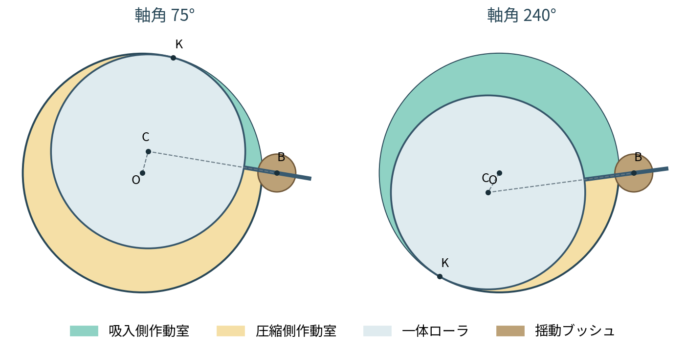
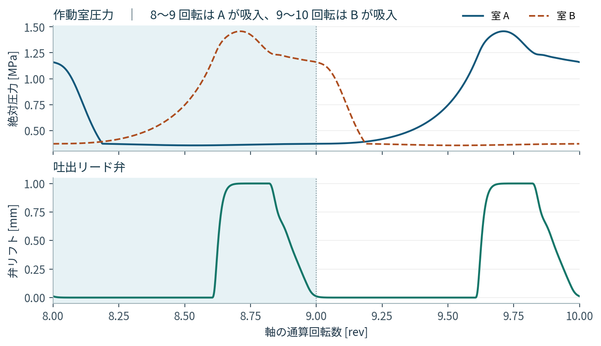

# ノーベルコンプレッサー

## 一体ブレードと揺動ブッシュ

単気筒・断熱の角度分解モデルです。ローラとブレードを一体の剛体とし、偏心軸が一回転する間の吸入、圧縮、吐出を追跡します。ブレードは固定中心を持つブッシュの溝を往復し、同時にブッシュとともに傾きます。ブレードとローラの間に接触線や先端すきまを設ける必要がありません。



O はシリンダ中心、C はローラ中心、B はブッシュ中心、K はローラと内壁の最近接点です。線分 CB がブレードの方向を決めます。三日月状の空間を CB 上のブレードと K で二つの作動室に分けます。図の色は1回転中の室の役割を示します。

- **PistonBlade（一体ローラ・ブレード）** が偏心軸角からブレード位置・角度・二室の容積を計算します。容積ポートで受けた室圧、摺動力、揺動トルクを軸トルクに換算します。[Modelica](Components/Rotary/Nobel/PistonBlade.mo)
- **SwingBush（揺動ブッシュ）** が並進フランジでブレードの相対摺動、回転フランジでブッシュの揺動を受け、両者の摩擦と揺動慣性を計算します。共通回路内のインスタンス名は `vane` です。[Modelica](Components/Rotary/Nobel/SwingBush.mo)
- **NobelCompressor（完成圧縮機）** は一体ローラとブッシュを二つのフランジで接続します。冷媒はアキュームレータ、吸入管、シリンダ、吐出リード弁、マフラ、高圧プレナム、吐出管の順に流れます。[Modelica](Components/Rotary/NobelCompressor.mo)

## 機構と作動室容積の式

シリンダ半径を $R$、偏心量を $e$、ローラ半径を $r=R-e$、高さを $H$ とします。ブッシュ中心は固定点 $(B,0)$ で、$B=R+\text{pivotOffset}$ です。軸角 $\theta$ の原点はローラと内壁の最近接点がブッシュ側に来る位置です。ローラ中心、中心間距離、揺動角、相対摺動変位は次式です。

$$
\begin{aligned}
 C &= (e\cos\theta,e\sin\theta),\\
 D &= \sqrt{(B-e\cos\theta)^2+(e\sin\theta)^2},\\
 \beta &= \operatorname{atan2}(-e\sin\theta,B-e\cos\theta),\qquad x=D-(B-e).
\end{aligned}
$$

摺動ストロークは $2e$、最大揺動角は $\arcsin(e/B)$ です。$q=B\sin\beta$ と置くと、ローラ中心からブレード中心線とシリンダ内壁の交点までの距離は $L=\sqrt{R^2-q^2}-B\cos\beta+D$ です。外周円弧・ローラ円弧・ブレード中心線で囲まれた断面積に高さを掛けて、吸入側の掃引容積 $S$ を求めます。$\alpha$ は現在の回転内の軸角（0～$2\pi$）です。

$$
S=\frac{H}{2}\left[(R^2-r^2)(\alpha-\beta)
   +R^2\arcsin(q/R)+Lq\right],\qquad V_d=\pi H(R^2-r^2).
$$

死容積 $V_c=0.025V_d$ の既定値では、吸入側が $V_c+S$、圧縮側が $V_c+V_d-S$ です。1回転ごとに室 A と B の役割を交代し、容積と各室の冷媒状態を連続に保ちます。共通部品 `PartialChamberGeometry` が回転数、役割の交代、二室の容積・容積速度を管理します。[共通の容積機構](Components/Rotary/BaseClasses/PartialChamberGeometry.mo)

## 軸動力、損失、漏れ

フランジの座標には $x$ と $\beta$ を使います。軸角微分は $x'=Be\sin\theta/D$、$\beta'=(e^2-Be\cos\theta)/D^2$ です。$F$ と $T$ をブッシュ側に入る力とトルクとすると、機構が軸に要求するトルクは次式です。$V_A'$ は室 A の容積を軸角で微分した値です。

$$
\tau_{\mathrm{shaft}}=-(p_A-p_B)V_A'+F x'+T\beta'.
$$

速度 $v=\dot x$、揺動角速度 $\omega_b=\dot\beta$ に対して、摺動力、揺動摩擦トルク、ブッシュ側トルク、散逸動力は次式です。速度の反転で摩擦が連続に切り替わるよう双曲線正接を使います。

$$
\begin{aligned}
 F &= c_xv+F_c\tanh(v/v_0), & v_0&=0.02\;\mathrm{m/s},\\
 T_f &= c_b\omega_b+T_c\tanh(\omega_b/\omega_0), & \omega_0&=1\;\mathrm{rad/s},\\
 T &= J_b\dot\omega_b+T_f, &
 P_{\rm slide}&=Fv,\qquad P_{\rm pivot}=T_f\omega_b.
\end{aligned}
$$

一体ピストンの自転とブッシュの揺動は同じ角速度で、合成慣性の蓄積エネルギーは $J_b\omega_b^2/2$ です。一体ピストンの重心をローラ中心に置く近似を用い、公転の慣性は駆動側の等価慣性に含める想定です。損失集計の `Channel.vane` に摺動・揺動の摩擦動力の和が入り、断熱モデルの `driveLoss` から機外へ散逸します。[共通の案内機構ポート](Components/Rotary/BaseClasses/PartialBladeGuide.mo)

各作動室について $d m_i/dt=\sum\dot m_{i}$、$d U_i/dt=\sum\dot m_i h_{\rm up}-p_i\dot V_i$ を解き、ExternalMedia から冷媒物性を取得します。一体ブレードの先端漏れは常にゼロです。A・B 間の漏れはローラ外周・上端面・下端面の符号付き和で、各経路が上流のエンタルピーを運びます。外周・端面のガス流量式は共通シリンダの薄いすきま流れに従います。[すきまの流量式](PhysicalEquations.md#シリンダの半径すきまと端面すきま)

ブレード厚さ、背室圧力、ブレード側面・ブッシュ外周から背室へ至る漏れ、油と冷媒の二相漏れは省略しています。摩擦力とトルクの係数は一定で、差圧によるブッシュ荷重との連成は今後の精密化の対象です。

## 容積の微分から軸の負荷を求める

`roller` が容積を与え、`cylinder.pocketA` と `pocketB` がその容積で圧力を解きます。回転角を $\theta$ [rad]、$\omega=\dot\theta$ [rad/s] とし、プライムは $\theta$ に関する微分とします。$C_q=\sqrt{R^2-q^2}$ が `chord`、$L$ が `bladeRadius` です。実装は次の解析微分を使います。[PistonBlade](Components/Rotary/Nobel/PistonBlade.mo)

$$
\begin{aligned}
D'&=Be\sin\theta/D, & \beta'&=(e^2-Be\cos\theta)/D^2,\\
q'&=B\cos\beta\,\beta', & L'&=-qq'/C_q+B\sin\beta\,\beta'+D',\\
S'&=\frac{H}{2}\left[(R^2-r^2)(1-\beta')+
        R^2 q'/C_q+L'q+Lq'\right].
\end{aligned}
$$

$n=\lfloor\theta/(2\pi)\rfloor$、$\alpha=\theta-2\pi n$。$V_c=f_cV_d$、偶数回転で $\sigma=+1$、奇数回転で $\sigma=-1$ と置くと、`fillingA` は $\sigma=+1$ のとき真です。適用幾何には $e<R/2$ の初期検査があります。[二室の容積ポートと回転番号](Components/Rotary/BaseClasses/PartialChamberGeometry.mo)

$$
\begin{aligned}
V_A&=V_c+\begin{cases}S&n=2k\\ V_d-S&n=2k+1\end{cases},
& V_B&=2V_c+V_d-V_A,\\
\dot V_A&=\sigma S'\omega,&\dot V_B&=-\dot V_A .
\end{aligned}
$$

例えば第1回転の終端では A が最大容積、B が死容積にあります。次の回転で A を圧縮側へつなぎ、B の残留ガスを膨張させます。室ごとの $p,h$ はそのまま積分を続けます。容積ポートの `effort` は気体側で $-p$、機構側で $+p$ なので、図示動力は $P_i=-(p_A-p_B)\dot V_A$ [W] です。

並進接続では `roller.follower.f` $=-F$、回転接続では `roller.pivot.tau` $=-T$ です。前節の軸トルクに $\omega$ を掛けると、圧力仕事、ブッシュの蓄積、摩擦の各項を単独で検算できます。[ブッシュの運動と損失](Components/Rotary/Nobel/SwingBush.mo) ／ [二つのフランジの接続](Components/Rotary/NobelCompressor.mo)

$$
\tau_{\rm shaft}\omega
=P_i+\frac{d}{dt}\left(\frac{J_b\dot\beta^2}{2}\right)
   +P_{\rm slide}+P_{\rm pivot}.
$$

## 二室の流路と漏れの収支

吸入室を $f$、圧縮室を $c$ とします。偶数回転は $(f,c)=(A,B)$、奇数回転は $(B,A)$ です。吸入管出口からの流入量 $s=A_sG(p_{\rm in},p_f,\rho_{\rm in})$ は $A_s=95$ mm² と片方向ノズル流束 $G$ で計算します。圧縮室の $p_c,h_c$ がリード弁入口へ渡り、実際に弁を通った吐出量を $d\ge0$ とします。[シリンダのポート割当](Components/Rotary/BaseClasses/PartialCylinder.mo) ／ [ノズルの流束式](PhysicalEquations.md#吸入漏れ吐出弁に共通のノズル式)

### 外周・上端面・下端面

各経路の流量 $\ell_k$ [kg/s] は A→B を正とします。$\Delta p=p_A-p_B$、上流・下流を $u,dn$、$\bar\rho=\rho_u(1+p_{dn}/p_u)/2$、$\mu_u$ を上流状態の粘度とします。すきま $g$、幅 $w$、有効長 $L_k$ に対して、粘性流量をノズル上限 $b$ で制限します。[薄いすきまの関数](Components/Rotary/BaseClasses/slitLeakFlow.mo) ／ [寸法の定義](Components/Rotary/BaseClasses/CylinderClearances.mo)

$$
b=wg\,G(p_u,p_{dn},\rho_u),\qquad
\ell_k=\begin{cases}
0&g=0,\\
\operatorname{clip}\!\left(\dfrac{wg^3\bar\rho\,\Delta p}{12\mu_u L_k},-b,b\right)&g>0 .
\end{cases}
$$

$\operatorname{clip}(z,l,u)=\min(u,\max(l,z))$。外周は $w=H$、$L_k=(3\pi/8)\sqrt{2rRg/e}$。上・下端面には各 $w=6$ mm、$L_k=5$ mm を用います。部品単体の追加すきま既定値は全てゼロ、ノーベルの実行例では外周・上・下を 5・8・8 µm としています。ブレード先端は `vane.leakArea=0`。ガスの端面漏れと、軸に負荷を与える端面油膜せん断は別々の量です。

### 質量とエンタルピーの向き

$\ell=\ell_{\rm radial}+\ell_{\rm top}+\ell_{\rm bottom}$、漏れが運ぶエンタルピー流率は $H_\ell=\ell h_{\rm up}$。$h_{\rm up}$ は $\ell\ge0$ で $h_A$、$\ell<0$ で $h_B$ です。$I=1$ を A 吸入、$I=0$ を B 吸入とすると、両室の質量と内部エネルギーは次式に従います。

$$
\begin{aligned}
\dot M_A &= I s-(1-I)d-\ell, &
\dot M_B &=(1-I)s-I d+\ell,\\
\dot U_A &= I s h_{\rm in}-(1-I)d h_A-H_\ell-p_A\dot V_A,\\
\dot U_B &=(1-I)s h_{\rm in}-I d h_B+H_\ell-p_B\dot V_B .
\end{aligned}
$$

両式を足すと内部漏れの質量とエンタルピーが相殺されます。`cylinder.leakAB` は符号付きの瞬時値、`losses.meanLeakRate` は完了した1回転の $|\ell|$ の時間平均です。[断熱シリンダ](Components/Rotary/Adiabatic/Cylinder.mo) ／ [損失集計](Components/Rotary/LossReport.mo)

## 初期条件と圧縮機全体の動力

単体例では境界の絶対圧を $p_s,p_d$ とし、$h_s=h(p_s,T_{\rm sat}(p_s)+5\,{\rm K})$、$h_{d,0}=h_s+[h_{is}(p_d,s_s)-h_s]/0.72$ を計算します。$s_s$ は吸入状態の比エントロピー。0.72 は初期状態を決める係数です。運転中の吐出比エンタルピーは作動室と容器のエネルギー収支で決まります。[境界の定義](Examples/BaseClasses/PartialCompressorBench.mo) ／ [初期値の割当](Examples/BaseClasses/PartialRotaryBench.mo)

| 単体例の冷媒容積 | 初期圧力 | 初期比エンタルピー |
|---|---:|---:|
| アキュームレータ | $0.989p_s$ | $h_s$ |
| 室 A（死容積）／室 B（最大容積） | $1.030p_d$ ／ $0.988p_s$ | $h_{d,0}$ ／ $h_s$ |
| 吐出マフラ／断熱高圧プレナム | $1.025p_d$ ／ $1.012p_d$ | ともに $h_{d,0}$ |

軸角は 0、初速は指令値 $2\pi\,\mathrm{speed}$、モーター積分トルクは 2.3 N·m、弁リフトとリフト速度はゼロから始めます。`NobelStandalone` はアキュームレータ入口の逆止弁を有効にします。`NobelCooling` の吸入・吐出圧力は冷房回路から与えられ、初期容積には組立側の設定を使います。[単体例](Examples/CompressorTests/NobelStandalone.mo) ／ [サイクル例](Examples/CoolingCycles/NobelCooling.mo)

上表の五つの冷媒容積の集合を $\mathcal V$、モーターの等価慣性を $J_m$ とします。$P_{\rm em}=\tau_{\rm drive}\omega$ とすると、`charge`、`E`、`driveLoss` の中身と圧縮機境界の収支は次式です。$j_i,j_o$ は部品へ入る向きを正とする外部ポート流量、$h_i,h_o$ は順方向運転の吸入・吐出比エンタルピーです。[共通組立](Components/Rotary/BaseClasses/PartialRollingPiston.mo) ／ [断熱版の動力収支](Components/Rotary/AdiabaticRollingPistonCompressor.mo)

$$
\begin{aligned}
M&=\sum_{\mathcal V}M_k, &
E&=\sum_{\mathcal V}U_k+\tfrac12 J_m\omega^2+\tfrac12 J_b\dot\beta^2,\\
P_{\rm loss}&=(P_{\rm el}-P_{\rm em})+
 (\tau_{\rm bearing}+\tau_{\rm film})\omega+P_{\rm slide}+P_{\rm pivot},\\
\dot M&=j_i+j_o, &
\dot E&=j_i h_i+j_o h_o+P_{\rm el}-P_{\rm loss}.
\end{aligned}
$$

例題の `useDetailedLosses=true` で銅損・鉄損と端面油膜せん断を有効にします。圧損の診断値は上流体積流量と差圧から求めます。吸入側はアキュームレータ入口・吸入管・吸気口、吐出側はリード弁・マフラ出口・吐出管の和です。この診断値を `driveLoss` に加えると圧力仕事を二重に数えます。弁のリフトは開口を決める動的な変数で、上の $E$ の機械蓄積項は回転子と揺動部です。[電気・軸受・端面の損失式](PhysicalEquations.md#電気入力から電磁動力へ) ／ [弁と下流流路の式](PhysicalEquations.md#吐出リード弁のリフトと流量)

## 二回転の室圧と弁リフトを読む



R134a の `NobelStandalone` を 0.23 s 実行し、軸角が8回転から10回転に達するまでの区間を抜き出しました。上図の実線・破線は `compressor.cylinder.pocketA.p` と `compressor.cylinder.pocketB.p`、下図は `compressor.reed.lift` です。9回転の境界で吸入・圧縮の担当が入れ替わり、共通の吐出弁を次の高圧室が駆動します。下図の山は弁の開いている期間に対応します。[単体例の設定](Examples/CompressorTests/NobelStandalone.mo)

同じ波形を OMEdit で確認するには、3変数を圧力・リフトの二つのプロットに分けます。時刻を軸角と対応させるには `compressor.roller.shaft.phi` [rad] を選び、$2\pi$ で割ります。

## 実行例と検証

OMEdit で `AirConditionerCycle/package.mo` を開きます。**Examples → CompressorTests → NobelStandalone** が圧縮機単体、**Examples → CoolingCycles → NobelCooling** が冷房サイクルです。単体例では `compressor.roller.beta` が揺動角 [rad]、`compressor.vane.slideLoss` と `pivotLoss` が各摩擦動力 [W]、`dischargeFlow` が吐出管出口の流量 [kg/s] です。サイクル例の `meanDelivery` と `meanPower` は完了した直前1回転の平均です。[単体例](Examples/CompressorTests/NobelStandalone.mo)・[サイクル例](Examples/CoolingCycles/NobelCooling.mo)

既定は R134a、回転数指令 3,000 rpm。単体例の吸入・吐出の飽和温度は 7 °C、45 °C、吸入過熱度は 5 K です。CO₂ は亜臨界の −10 °C、8 °C を使用します。例題の仮定寸法は $R=24$ mm、$e=4.5$ mm、$H=45.5$ mm、$B=27$ mm です。行程容積は 27.98 cm³/rev、摺動ストロークは 9.0 mm、最大揺動角は 9.59° です。外周・上下の有効気体すきまは 5・8・8 µm です。

例題では摺動摩擦力 3 N、摺動粘性 1.6 N·s/m、揺動摩擦トルク 0.015 N·m、揺動粘性 0.0001 N·m·s/rad、合成揺動慣性 $2.5\times10^{-5}$ kg·m² を仮定しています。流量と電力は短時間計算の最終完了回転平均で、寸法と係数は実機データでの同定を要します。

### シミュレーション結果

OpenModelica 1.27.2、Modelica 4.1.0、ExternalMedia 4.1.1。各単体例を 0.23 s 実行し、質量収支、全エネルギー収支・断熱ガス収支、作動室容積の独立した多角形計算、ブレードの運動、摩擦の符号と集計、漏れの内訳を照合しました。

| 冷媒 | 完了回転数 | 吐出流量 [g/s] | 電力 [W] | 吐出温度 [°C] |
|---|---:|---:|---:|---:|
| R134a | 11 | 22.32 | 793.5 | 61.7 |
| R290 | 11 | 15.49 | 1007.5 | 61.1 |
| R32 | 11 | 33.23 | 2001.9 | 90.2 |
| R410A | 11 | 46.30 | 1912.5 | 73.9 |
| CO₂ | 10 | 81.83 | 2667.2 | 34.7 |

CO₂ は既定のモータートルク上限 8 N·m に達し、最終完了回転は約 2,734 rpm です。

R134a の冷房サイクル例は 0.21 s で10回転を完了し、第10回転の吐出量は 21.90 g/s、電力は 793.4 W でした。回路全体のエネルギー収支の最大残差は 0.0053 J です。[単体5冷媒の数値・残差](Resources/Reference/nobel_standalone.csv)

試験を再実行するには、パッケージのディレクトリで次のコマンドを実行します。全5冷媒の単体例と R134a 冷房サイクル例が対象です。

```sh
python Resources/Scripts/run_nobel_tests.py --fluid all
```
