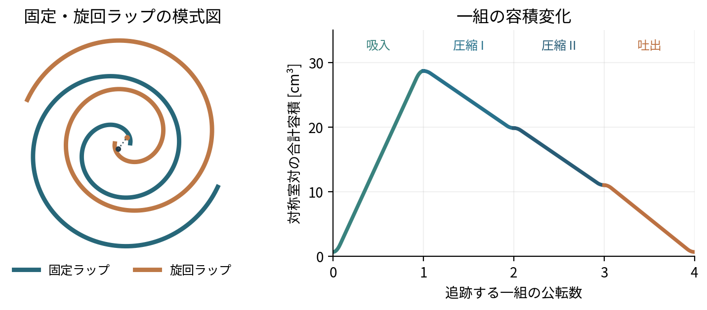

# スクロール圧縮機

## 固定ラップと旋回ラップ

固定スクロールに対し、もう一方のスクロールが自転を拘束された状態で公転します。外周で吸入したガスをラップの内側へ移しながら圧縮し、中央吐出口につなぎます。このモデルは対称な二つの室を同一圧力・同一比エンタルピーの一組にまとめ、四組を同時に追跡します。各組は吸入1公転、閉じ込み圧縮2公転、中央吐出1公転を経て再び吸入に入ります。



左はインボリュートの模式図です。右はモデルに実装した容積則です。行程容積と内蔵容積比を独立に設定する方式で、ラップ端部の図面から接触点を計算する際の代替として、近似した容積曲線を用います。

- **Dimensions** が基礎円半径、歯厚、ラップ高さ、行程容積、内蔵容積比を定義します。[定義](Components/Scroll/Dimensions.mo)
- **WrapGeometry** が軸角から4組の役割、容積、容積速度、ポート開度を計算し、各組の圧力を軸トルクに戻します。[容積機構](Components/Scroll/WrapGeometry.mo)
- **OrbitDrive** が直交するオルダム継手の摺動抵抗と旋回質量の慣性を扱います。[旋回駆動部](Components/Scroll/OrbitDrive.mo)
- **PocketSet** が作動室、外周吸入口、中央吐出口、中央の固定容積を持ちます。**ClearancePath** が隣り合う室の歯先漏れと側面漏れを結びます。[作動室](Components/Scroll/PocketSet.mo)・[漏れ通路](Components/Scroll/ClearancePath.mo)

## 作動室の容積と公転

基礎円半径 $r_b$、厚さ $t$ の理想的な対称ラップについて、旋回半径を $e_o=\pi r_b-t$ とします。軸角 $\theta$ で旋回中心は $x=e_o\cos\theta,\ y=e_o\sin\theta$ にあり、スクロールの姿勢角は一定です。ポケットの段階は1公転ごとに交代し、質量・内部エネルギーはそれぞれの室に連続して保持されます。

対称な両側を合わせた行程容積 $V_d$、残留容積 $V_0=f_dV_d$、吸入閉鎖容積 $V_s=V_0+V_d$、内蔵容積比 $r_v$ による中央ポート開口容積 $V_o=V_s/r_v$ を使います。各段階の端の容積は順に

$$
K_1=V_0,\quad K_2=V_s,\quad K_3=(V_s+V_o)/2,\quad K_4=V_o,\quad K_5=V_0.
$$

公転の位相 $u\in[0,1]$ と端の平滑化幅 $a=0.08$ に対し、段階 $j$ の容積は $V_j=K_j+(K_{j+1}-K_j)f(u)$ です。通常区間で容積は軸角に線形で、公転境界では勾配がゼロに接続します。

$$
f(u)=\begin{cases}
u^2/[2a(1-a)] & 0\le u<a,\\
(u-a/2)/(1-a) & a\le u\le 1-a,\\
1-(1-u)^2/[2a(1-a)] & 1-a<u\le 1.
\end{cases}
$$

各瞬間に四つの段階が一組ずつ存在するので、$\sum_j\dot V_j=0$ です。圧縮室の図示動力は $P_i=-\sum_j p_j\dot V_j$、機構側の軸トルクは $-\sum_j p_j\,\partial V_j/\partial\theta$ です。四つの容積ポートが容積と圧力を受け渡し、容積速度・段階・開度は信号コネクタで作動室に伝わります。留まったガスは残留容積から次の吸入段階で再膨張します。

## 圧縮、漏れ、機械損失

各組の質量 $m_j$ と内部エネルギー $U_j=m_j h_j-p_jV_j$ は次式に従います。全冷媒容積を断熱とし、ExternalMedia の $p,h$ 物性から密度と温度を求めます。

$$
\dot m_j=\sum_k \dot m_{kj},\qquad
\dot U_j=\sum_k \dot m_{kj}h_{\mathrm{up},k}-p_j\dot V_j .
$$

**吸入と吐出。** 外周吸入口は吸入向き、中央ポートは双方向です。圧縮不足で中央室圧が作動室圧を上回ると、吐出開始時にガスが一時的に中央から作動室へ戻ります。中央室の下流のリード弁が吐出管側からの逆流を遮断します。吸入・中央ポートは開き始めと閉じ終わりの各6%の公転角で面積を滑らかに変え、両端でゼロになります。流量は有効開口面積と上流状態による臨界圧力比付きノズル質量流束 $G$ の積です。[ノズルの式](Components/Rotary/BaseClasses/massFlux.mo)

**歯先と側面の漏れ。** 隣接段階の間に三つの有効通路を取り、吐出段階と吸入段階を直結する経路は閉じます。歯先と対向鏡板の軸方向すきま $g_t$、ラップ側面間のすきま $g_f$ に対し、同じ符号付き流束 $G_{AB}$ を使います。

$$
\dot m_t=C_t L_tg_tG_{AB},\qquad
\dot m_f=C_f N_f H g_fG_{AB}.
$$

$L_t$ は対称二室分の有効歯先長、$H$ はラップ高さ、$N_f$ は有効側面通路数です。高圧室から低圧室へ上流比エンタルピーを運び、各質量・エンタルピー流率を両室の収支に逆符号で加えます。有効オリフィスの仮定により流量は設定すきまに線形です。油膜や長い狭路の粘性抵抗は流量係数の校正範囲を別途確認する必要があります。

**オルダム継手。** 直交する二方向 $k=x,y$ の速度 $v_k=\dot k$ に対し $F_k=c v_k+F_c\tanh(v_k/v_0)$、$v_0=0.02$ m/s とし、$P_{\rm Oldham}=F_xv_x+F_yv_y$ を求めます。公転質量の蓄積エネルギーは $m_o e_o^2\dot\theta^2/2$ です。電動機損失・軸受摩擦・継手摩擦をまとめた `driveLoss` は機外への散逸とします。ラップの弾性変形、軸方向の押付け・背圧、油と冷媒の二相漏れ、壁との伝熱は対象外です。

## 単体例と冷房サイクル例

パッケージの `package.mo` を OMEdit で開き、**Examples → CompressorTests → ScrollStandalone** で吸入・吐出境界付き単体試験、**Examples → CoolingCycles → ScrollCooling** で圧縮機を接続した冷房サイクルを実行します。[単体例](Examples/CompressorTests/ScrollStandalone.mo)・[サイクル例](Examples/CoolingCycles/ScrollCooling.mo)

**ScrollCompressor** の冷媒回路はアキュームレータ → 吸入管 → 四組の作動室 → 中央室 → 吐出リード弁 → マフラ → 高圧プレナム → 吐出管です。モーター、軸受、旋回駆動部、容積機構を回転フランジで接続しています。電気入力・吐出流量の直前公転平均は `compressor.meanPower`、`compressor.meanDelivery` です。作動室1の圧力は `compressor.pockets.pocket[1].p`、段階番号は `compressor.wraps.stage[1]` です。[構成と接続図](Components/Scroll/ScrollCompressor.mo)

既定値は $V_d=28$ cm³/rev、$r_v=2.6$、$f_d=0.025$、$r_b=2.3$ mm、歯厚 3 mm、ラップ高さ 24 mm。歯先すきまは 4 µm、側面すきまは 5 µm、流量係数は各 0.45、0.55、歯先有効長は 55 mm、側面通路数は 2 です。どの値も比較用の仮定値です。`compressor.geometry.builtInRatio` で開口時の圧縮度を、`compressor.pockets.seal(each tipGap=0,each flankGap=0)` で漏れ経路を変更できます。

### シミュレーション結果

OpenModelica 1.27.2、Modelica 4.1.0、ExternalMedia 4.1.1。回転数指令 3,000 rpm、吸入過熱度 5 K。単体境界は飽和温度 7 °C と 45 °C、CO₂ は亜臨界の −10 °C と 8 °C です。流量と電力は完了した直前の1公転平均です。

| 単体冷媒 | 時間 [s] | 完了公転数 | 実回転数 [rpm] | 吐出 [g/s] | 電力 [W] |
|---|---:|---:|---:|---:|---:|
| R134a | 0.12 | 6 | 3000 | 22.30 | 725.2 |
| R290 | 0.105 | 5 | 3002 | 15.55 | 950.1 |
| R32 | 0.105 | 5 | 3006 | 33.24 | 1860.5 |
| R410A | 0.105 | 5 | 3007 | 46.16 | 1708.3 |
| CO₂ | 0.105 | 4 | 2413 | 75.87 | 2395.3 |

CO₂ の単体例はモーターのトルク上限 8 N·m に達し、第4公転の平均回転数は約 2,413 rpm です。

R134a 単体の歯先漏れは 0.98 g/s、側面漏れは 1.31 g/s でした。各値は隣接3経路の絶対流量を合計した公転平均です。両すきまをゼロにした別試験では両経路の流量がゼロになりました。R134a の冷房サイクル例は 6 公転を完了し、吐出 21.78 g/s、電力 725.2 W、全回路のエネルギー収支の最大残差は 0.0012 J でした。形状・摩擦・シール係数の仮定に依存する短時間の試算です。[7条件の結果と残差](Resources/Reference/scroll_compressor.csv)

再実行はパッケージのディレクトリから次のコマンドを使用します。各作動室の連続した容積・圧力応答、隣接関係、漏れの方向、図示仕事、機械損失、全体の質量・エネルギー収支を照合します。

```sh
python Resources/Scripts/run_scroll_tests.py --fluid all
```
